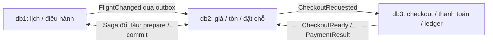

# Airline Smart — tinh gọn cấu trúc Database cốt lõi

Ngày: 13/11/2026, Asia/Ho_Chi_Minh. Thực hiện trực tiếp trên Docker local trong Ubuntu WSL. Không commit/push, không reset/stash Git. Giữ các thay đổi giao diện và M02/M03 đã có.

## 1. Kết quả thực tế

- **Xóa 39 bảng** trên bản sao; hệ thống đang dùng **84 bảng**.
- Bản ghi: **282,859 → 160,602**, loại **122,257 bản ghi**.
- Trong đó lưu trữ khỏi bộ active **14,006 nhóm đặt chỗ demo lịch sử**, cùng dữ liệu con; không xóa tài khoản, sân bay, hạ tầng, đường bay, kế hoạch hay chuyến bay.
- Dung lượng cấp phát tablespace của bộ Database active: **229.93 MiB (241,098,752 B) → 123.66 MiB (129,667,072 B)**, giảm **106.27 MiB (111,431,680 B)**, tương đương **46.22%**.
- Database local đã chuyển sang **`airline_core_20261113` trên cả ba node**, dùng user ứng dụng `airline`. Database gốc **`airline` giữ nguyên**, không bị reset/xóa/ghi đè.
- Backend sau tinh gọn đạt **7 test, 257 assertions**, cộng nghiệp vụ HTTP/trình duyệt và kiểm tra điều hướng. Các màn hình ngoài phạm vi vẫn rỗng; Sidebar không thay bố cục.

Các số lượng và dung lượng trong báo cáo là số đã đo. Mốc trước: `original.json`; mốc sau: `candidate-final.json` ngay trước chuyển local. Sau mốc này, thao tác đăng nhập/nghiệp vụ bình thường có thể bổ sung audit hoặc dữ liệu mới.

## 2. Kiến trúc trước/sau

| Docker node | Kết nối Laravel | Trước | Sau | Vai trò |
|---|---|---|---|---|
| db1 | ops | airline | airline_core_20261113 | M01/M02/M03, tàu, tổ bay, bảo dưỡng tối thiểu, tài nguyên |
| db2 | mysql | airline | airline_core_20261113 | Auth, đặt chỗ, giá/tồn, vé, thông báo và phục hồi hành khách |
| db3 | finance | airline | airline_core_20261113 | Checkout, thanh toán, hoàn tiền, sổ giao dịch, audit/outbox/inbox |

Đã xác minh container, cấu hình host, tên schema, ba UUID riêng biệt và bind web `127.0.0.1:8000` trước khi làm. Không truy cập DB production hoặc DB dùng chung bên ngoài bộ Docker local này.

- ops: `5ff9b159-da0e-11f1-9e7c-567f6d734d65`; hostname `d2b8725b56e1`.
- mysql: `5fcfc91b-da0e-11f1-8cbf-52177f005c50`; hostname `d1186693c3f3`.
- finance: `6037f2f1-da0e-11f1-9fba-0aad7f9bf25c`; hostname `38f73e533e5a`.

Đây là ba nguồn ghi độc lập, không phải ba replica đọc. Không đổi cơ chế đồng bộ: `Events` → outbox → `OutboxRelay`/`WorkflowRelay` → inbox, có idempotency. Worker tiếp tục giải phóng giữ chỗ, chuyển sự kiện và xử lý mail. Đã **bỏ tác vụ CRM escalation** khỏi worker vì không còn thuộc phạm vi.

## 3. Tổng hợp số lượng và dung lượng

| Node | Số bảng trước | Số bảng sau | Bản ghi trước | Bản ghi sau | Dung lượng trước | Dung lượng sau |
|---|---:|---:|---:|---:|---:|---:|
| ops | 56 | 40 | 17,556 | 17,550 | 20.55 MiB (21,544,960 B) | 14.80 MiB (15,523,840 B) |
| mysql | 51 | 37 | 149,691 | 80,608 | 132.85 MiB (139,304,960 B) | 69.34 MiB (72,708,096 B) |
| finance | 16 | 7 | 115,612 | 62,444 | 76.53 MiB (80,248,832 B) | 39.52 MiB (41,435,136 B) |
| **Tổng** | **123** | **84** | **282,859** | **160,602** | **229.93 MiB (241,098,752 B)** | **123.66 MiB (129,667,072 B)** |

Dung lượng là **`information_schema.INNODB_TABLESPACES.ALLOCATED_SIZE`**, số byte tablespace thực được cấp phát cho từng bảng, gồm dữ liệu/index trong `.ibd`. Không dùng `TABLE_ROWS`, `DATA_LENGTH` hoặc `INDEX_LENGTH` ước lượng làm kết quả thực tế. Artifact còn ghi `FILE_SIZE` riêng. MiB hiển thị làm tròn; số byte trong ngoặc là số đo nguyên.

Đã import vào schema riêng, xóa đúng ID và dùng `OPTIMIZE TABLE` **chỉ trên bản core**, sau diễn tập để thu hồi phần cấp phát rỗng. Không tắt FK. Một phần mức giảm là do tái tổ chức tablespace khi import/rebuild, không quy toàn bộ số byte giảm cho việc xóa bản ghi. `preservation.json` ghi thêm dung lượng bản restore trước xóa để phân biệt.

**Tổng dung lượng ổ đĩa máy không giảm tương ứng**, vì vẫn giữ schema gốc, bản nghiệm thu và các file backup theo yêu cầu rollback. Số liệu trên chỉ so sánh bộ Database phục vụ ứng dụng.

## 4. Danh sách bảng đã xóa

Chỉ áp dụng bằng `airline:core-prune apply` trên tên schema core cố định và host Docker đã xác nhận. Không có migration phá hủy chạy mặc định trên máy khác/production. Trước DROP đã kiểm tra FK đi vào, thứ tự child→parent, trigger/view/routine và từng fingerprint. Cả ba schema nguồn không có view/trigger/routine nghiệp vụ.

| Bảng xóa | Bản ghi lưu trữ | Byte cấp phát trước | Tham chiếu nguồn | Căn cứ |
|---|---:|---:|---|---|
| ops.aircraft_models | 0 | 131,072 | Framework / service dùng tên bảng động; xem source-references.json | Danh mục/phần mở rộng chỉ được use case và màn hình đã ngừng dùng; giữ kiểm tra nguồn lực trên hồ sơ chính. |
| ops.crew_availability | 0 | 147,456 | Framework / service dùng tên bảng động; xem source-references.json | Danh mục/phần mở rộng chỉ được use case và màn hình đã ngừng dùng; giữ kiểm tra nguồn lực trên hồ sơ chính. |
| ops.crew_qualifications | 0 | 147,456 | Framework / service dùng tên bảng động; xem source-references.json | Danh mục/phần mở rộng chỉ được use case và màn hình đã ngừng dùng; giữ kiểm tra nguồn lực trên hồ sơ chính. |
| ops.crew_rosters | 0 | 147,456 | Framework / service dùng tên bảng động; xem source-references.json | Danh mục/phần mở rộng chỉ được use case và màn hình đã ngừng dùng; giữ kiểm tra nguồn lực trên hồ sơ chính. |
| ops.devices | 6 | 131,072 | `app/Modules/Analytics/AnalyticsService.php` | AI/IoT độc lập; CLI IoT bị ngừng, không có consumer cốt lõi. |
| ops.ground_equipment | 0 | 147,456 | `app/Modules/Operations/InfrastructureFixtures.php`; `app/Modules/Operations/InfrastructureSimplification.php`; `app/Http/Controllers/InfrastructureReferenceController.php` | Danh mục/phần mở rộng chỉ được use case và màn hình đã ngừng dùng; giữ kiểm tra nguồn lực trên hồ sơ chính. |
| ops.ground_services | 0 | 147,456 | Framework / service dùng tên bảng động; xem source-references.json | Danh mục/phần mở rộng chỉ được use case và màn hình đã ngừng dùng; giữ kiểm tra nguồn lực trên hồ sơ chính. |
| ops.ground_task_equipment | 0 | 167,936 | Framework / service dùng tên bảng động; xem source-references.json | Danh mục/phần mở rộng chỉ được use case và màn hình đã ngừng dùng; giữ kiểm tra nguồn lực trên hồ sơ chính. |
| ops.ground_task_handoffs | 0 | 131,072 | Framework / service dùng tên bảng động; xem source-references.json | Danh mục/phần mở rộng chỉ được use case và màn hình đã ngừng dùng; giữ kiểm tra nguồn lực trên hồ sơ chính. |
| ops.ground_task_services | 0 | 167,936 | Framework / service dùng tên bảng động; xem source-references.json | Danh mục/phần mở rộng chỉ được use case và màn hình đã ngừng dùng; giữ kiểm tra nguồn lực trên hồ sơ chính. |
| ops.integration_connections | 0 | 131,072 | Framework / service dùng tên bảng động; xem source-references.json | Danh mục/phần mở rộng chỉ được use case và màn hình đã ngừng dùng; giữ kiểm tra nguồn lực trên hồ sơ chính. |
| ops.maintenance_items | 0 | 147,456 | Framework / service dùng tên bảng động; xem source-references.json | Danh mục/phần mở rộng chỉ được use case và màn hình đã ngừng dùng; giữ kiểm tra nguồn lực trên hồ sơ chính. |
| ops.maintenance_materials | 0 | 131,072 | Framework / service dùng tên bảng động; xem source-references.json | Danh mục/phần mở rộng chỉ được use case và màn hình đã ngừng dùng; giữ kiểm tra nguồn lực trên hồ sơ chính. |
| ops.telemetry | 0 | 147,456 | `app/Modules/Analytics/AnalyticsService.php` | AI/IoT độc lập; CLI IoT bị ngừng, không có consumer cốt lõi. |
| ops.work_order_items | 0 | 147,456 | Framework / service dùng tên bảng động; xem source-references.json | Danh mục/phần mở rộng chỉ được use case và màn hình đã ngừng dùng; giữ kiểm tra nguồn lực trên hồ sơ chính. |
| ops.work_order_materials | 0 | 167,936 | Framework / service dùng tên bảng động; xem source-references.json | Danh mục/phần mở rộng chỉ được use case và màn hình đã ngừng dùng; giữ kiểm tra nguồn lực trên hồ sơ chính. |
| mysql.analytics_dataset_records | 0 | 147,456 | Framework / service dùng tên bảng động; xem source-references.json | AI/IoT độc lập; CLI IoT bị ngừng, không có consumer cốt lõi. |
| mysql.analytics_datasets | 0 | 131,072 | Framework / service dùng tên bảng động; xem source-references.json | AI/IoT độc lập; CLI IoT bị ngừng, không có consumer cốt lõi. |
| mysql.analytics_model_runs | 0 | 147,456 | Framework / service dùng tên bảng động; xem source-references.json | AI/IoT độc lập; CLI IoT bị ngừng, không có consumer cốt lõi. |
| mysql.analytics_recommendations | 0 | 131,072 | Framework / service dùng tên bảng động; xem source-references.json | AI/IoT độc lập; CLI IoT bị ngừng, không có consumer cốt lõi. |
| mysql.baggage_allowances | 0 | 131,072 | Framework / service dùng tên bảng động; xem source-references.json | Danh mục/phần mở rộng chỉ được use case và màn hình đã ngừng dùng; giữ kiểm tra nguồn lực trên hồ sơ chính. |
| mysql.baggage_incidents | 0 | 147,456 | Framework / service dùng tên bảng động; xem source-references.json | Danh mục/phần mở rộng chỉ được use case và màn hình đã ngừng dùng; giữ kiểm tra nguồn lực trên hồ sơ chính. |
| mysql.customer_interactions | 0 | 147,456 | Framework / service dùng tên bảng động; xem source-references.json | CRM độc lập; bỏ tác vụ escalation khỏi worker, recovery không dùng CRM. |
| mysql.fare_rule_versions | 0 | 131,072 | Framework / service dùng tên bảng động; xem source-references.json | Danh mục/phần mở rộng chỉ được use case và màn hình đã ngừng dùng; giữ kiểm tra nguồn lực trên hồ sơ chính. |
| mysql.notification_deliveries | 0 | 167,936 | Framework / service dùng tên bảng động; xem source-references.json | Danh mục/phần mở rộng chỉ được use case và màn hình đã ngừng dùng; giữ kiểm tra nguồn lực trên hồ sơ chính. |
| mysql.notification_templates | 0 | 131,072 | Framework / service dùng tên bảng động; xem source-references.json | Danh mục/phần mở rộng chỉ được use case và màn hình đã ngừng dùng; giữ kiểm tra nguồn lực trên hồ sơ chính. |
| mysql.support_cases | 3 | 167,936 | `app/Support/WorkspaceForms.php`; `app/Modules/Customer/CustomerService.php` | CRM độc lập; bỏ tác vụ escalation khỏi worker, recovery không dùng CRM. |
| mysql.support_compensations | 0 | 131,072 | Framework / service dùng tên bảng động; xem source-references.json | CRM độc lập; bỏ tác vụ escalation khỏi worker, recovery không dùng CRM. |
| mysql.support_messages | 6 | 131,072 | `app/Modules/Customer/CustomerService.php` | CRM độc lập; bỏ tác vụ escalation khỏi worker, recovery không dùng CRM. |
| mysql.system_configurations | 0 | 131,072 | Framework / service dùng tên bảng động; xem source-references.json | Danh mục/phần mở rộng chỉ được use case và màn hình đã ngừng dùng; giữ kiểm tra nguồn lực trên hồ sơ chính. |
| finance.fee_catalog | 0 | 131,072 | `app/Http/Controllers/WorkspaceController.php` | Đối soát/báo cáo/cấu hình phí riêng; checkout, refund và ledger không đọc các bảng này. |
| finance.financial_adjustments | 0 | 131,072 | Framework / service dùng tên bảng động; xem source-references.json | Đối soát/báo cáo/cấu hình phí riêng; checkout, refund và ledger không đọc các bảng này. |
| finance.reconciliation_adjustments | 0 | 163,840 | Framework / service dùng tên bảng động; xem source-references.json | Đối soát/báo cáo/cấu hình phí riêng; checkout, refund và ledger không đọc các bảng này. |
| finance.reconciliation_entries | 11,148 | 12,587,008 | `app/Support/WorkspaceForms.php` | Đối soát/báo cáo/cấu hình phí riêng; checkout, refund và ledger không đọc các bảng này. |
| finance.reconciliation_imports | 0 | 131,072 | Framework / service dùng tên bảng động; xem source-references.json | Đối soát/báo cáo/cấu hình phí riêng; checkout, refund và ledger không đọc các bảng này. |
| finance.reconciliation_reason_codes | 0 | 131,072 | Framework / service dùng tên bảng động; xem source-references.json | Đối soát/báo cáo/cấu hình phí riêng; checkout, refund và ledger không đọc các bảng này. |
| finance.reconciliation_runs | 2 | 114,688 | `app/Support/WorkspaceForms.php` | Đối soát/báo cáo/cấu hình phí riêng; checkout, refund và ledger không đọc các bảng này. |
| finance.statement_batches | 0 | 131,072 | Framework / service dùng tên bảng động; xem source-references.json | Đối soát/báo cáo/cấu hình phí riêng; checkout, refund và ledger không đọc các bảng này. |
| finance.statement_rows | 0 | 147,456 | Framework / service dùng tên bảng động; xem source-references.json | Đối soát/báo cáo/cấu hình phí riêng; checkout, refund và ledger không đọc các bảng này. |

Những tham chiếu còn nằm trong seeder full-system hoặc source phục hồi không được coi là dependency runtime. Các nhánh controller và use case tương ứng đã bỏ/ngừng trước khi query, CLI IoT đã gỡ, worker không còn đọc CRM. File `source-references.json` chứa toàn bộ file/line tìm thấy, bao gồm migration/seeder; danh sách này hỗ trợ rà soát, không khẳng định mọi nhánh tham chiếu còn được triển khai.

### Thay đổi liên kết mẫu tàu bay

`aircraft_models` trống nhưng có FK `aircraft_model_id_foreign` từ `aircraft.model_id`. Đã xác minh **mọi model_id đều NULL**, code khai thác/lịch bay dùng trực tiếp `aircraft.type`, `capacity`, `seat_layout`, `status` và `work_orders`. Công cụ gỡ **đúng FK không dùng này trên bản core**, giữ cột nullable để tránh đổi fingerprint hồ sơ tàu bay. Nếu có model_id khác NULL, công cụ từ chối. Không vô hiệu hóa kiểm tra FK toàn cục; tất cả FK còn lại giữa các bảng giữ được đối chiếu nguyên vẹn.

Các bảng crew qualification/availability/roster mở rộng và material/item bảo dưỡng chỉ được chức năng quản trị đã ngừng đọc/ghi; không được core service hiện tại dùng để kiểm tra. Giữ nguyên kiểm tra thực tế trên `crew_members`/`crew_assignments` (năng định, giấy phép, giao ca/xung đột), `aircraft` và `work_orders`. Không thay chúng bằng kết quả thành công mặc định.

## 5. Dữ liệu lịch sử đã lưu trữ và giảm khỏi core

Điều kiện đồng thời cho một nhóm được loại:

1. Chuyến `ARRIVED`, đã có actual_arrival, có audit `demo.flight_snapshot`; giữ nguyên bản ghi chuyến.
2. Booking `BOARDED`, không thuộc reservation nhiều chặng/hành khách, idempotency khớp chính xác `demo-manifest-<flight_id>-<ordinal>` và tài khoản `demo.pNNNN@airline.test`.
3. Một payment `CAPTURED`, `mode=mock`, amount đúng bằng booking; một ledger `CAPTURE` cùng amount; ticket mang prefix `ASD` của seeder.
4. Checkout/intent nếu có đều mock và hoàn tất; không có quan hệ giữ lại như refund, đổi vé, revision, ancillary hoặc nghiệp vụ khác cần booking đó.
5. Hành lý nếu có chỉ `DELIVERED`/`OFFLOADED`; giữ mọi trường hợp chưa hoàn tất.
6. Giữ các ordinal `[0,1,2,4,5,6,12,13,14]` cho từng chuyến: ba mẫu BUSINESS, FLEX, ECONOMY với các phương thức VNPAY/MOMO/BANK theo seeder. Các ngoại lệ có phụ thuộc vẫn giữ thêm, không ép bằng đúng chín.

Không dùng riêng ngày cũ làm lý do xóa. Không giảm dữ liệu của chuyến đang khai thác, không xóa PNR thực hoặc giao dịch ngoài provenance demo này, không sửa ID bản ghi giữ. Không xóa ledger/payment của booking được giữ.

| Bảng giảm theo ID chính xác | Số bản ghi loại |
|---|---:|
| mysql.baggage_events | 10,875 |
| mysql.baggage | 2,175 |
| mysql.boarding_passes | 14,006 |
| mysql.tickets | 14,006 |
| mysql.checkout_sessions | 14,006 |
| finance.checkout_intents | 14,006 |
| finance.ledger_entries | 14,006 |
| finance.payments | 14,006 |
| mysql.bookings | 14,006 |

Các bảng bị DROP có thêm dữ liệu CRM, thiết bị và 11.150 dòng tổng hợp đối soát được lưu trong backup gốc; tổng hợp trước/sau từng bảng ở phần 6. Những dòng audit và outbox/inbox không bị xóa; lịch sử nghiệp vụ core giữ nguyên. ID/hash từng dòng dự định xóa nằm trong `plan.json`, cả dữ liệu/schema gốc nằm trong ba SQL backup và schema `airline`.

## 6. Phân loại và đối chiếu toàn bộ bảng

`CORE`: phục vụ trực tiếp phạm vi. `REQUIRED_DEPENDENCY`: có consumer cốt lõi hoặc nền tảng Auth/queue/audit/fixture bắt buộc. `REMOVABLE`: đã loại. `CAN_BE_SIMPLIFIED`: giữ cấu trúc nhưng giảm snapshot demo, hoặc thành phần cài đặt có thể tiếp tục giảm. Không gộp trường hợp chưa rõ vào REMOVABLE.

| Bảng | Phân loại | Trước | Sau | Số dòng loại | Byte trước | Byte sau | Mục đích / quyết định |
|---|---|---:|---:|---:|---:|---:|---|
| ops.aircraft | REQUIRED_DEPENDENCY | 39 | 39 | 0 | 147,456 | 147,456 | Kiểm tra khai thác, tài nguyên, hành khách hoặc giao dịch phụ thuộc. |
| ops.aircraft_models | REMOVABLE | 0 | 0 | 0 | 131,072 | 0 | Danh mục/phần mở rộng chỉ được use case và màn hình đã ngừng dùng; giữ kiểm tra nguồn lực trên hồ sơ chính. |
| ops.airport_areas | CORE | 0 | 0 | 0 | 200,704 | 200,704 | Nghiệp vụ M01–M03, đặt chuyến hoặc xác thực. |
| ops.airport_infrastructure | CORE | 783 | 783 | 0 | 282,624 | 278,528 | Nghiệp vụ M01–M03, đặt chuyến hoặc xác thực. |
| ops.airport_resources | CORE | 648 | 648 | 0 | 315,392 | 282,624 | Nghiệp vụ M01–M03, đặt chuyến hoặc xác thực. |
| ops.airports | CORE | 22 | 22 | 0 | 184,320 | 184,320 | Nghiệp vụ M01–M03, đặt chuyến hoặc xác thực. |
| ops.audit_logs | REQUIRED_DEPENDENCY | 2,078 | 2,078 | 0 | 9,441,280 | 7,344,128 | Giữ audit, định danh, đồng bộ, cấu hình và khả năng khôi phục. |
| ops.change_reservations | CORE | 0 | 0 | 0 | 184,320 | 163,840 | Nghiệp vụ M01–M03, đặt chuyến hoặc xác thực. |
| ops.crew_assignments | REQUIRED_DEPENDENCY | 5,948 | 5,948 | 0 | 987,136 | 954,368 | Kiểm tra khai thác, tài nguyên, hành khách hoặc giao dịch phụ thuộc. |
| ops.crew_availability | REMOVABLE | 0 | 0 | 0 | 147,456 | 0 | Danh mục/phần mở rộng chỉ được use case và màn hình đã ngừng dùng; giữ kiểm tra nguồn lực trên hồ sơ chính. |
| ops.crew_members | REQUIRED_DEPENDENCY | 406 | 406 | 0 | 167,936 | 163,840 | Kiểm tra khai thác, tài nguyên, hành khách hoặc giao dịch phụ thuộc. |
| ops.crew_qualifications | REMOVABLE | 0 | 0 | 0 | 147,456 | 0 | Danh mục/phần mở rộng chỉ được use case và màn hình đã ngừng dùng; giữ kiểm tra nguồn lực trên hồ sơ chính. |
| ops.crew_rosters | REMOVABLE | 0 | 0 | 0 | 147,456 | 0 | Danh mục/phần mở rộng chỉ được use case và màn hình đã ngừng dùng; giữ kiểm tra nguồn lực trên hồ sơ chính. |
| ops.demo_installations | CAN_BE_SIMPLIFIED | 0 | 0 | 0 | 131,072 | 131,072 | Marker cài đặt demo hiện trống; giữ cấu trúc tương thích với installer/fixture, compact installer không chạy tạo lại dữ liệu. Không phải dependency nghiệp vụ bắt buộc. |
| ops.devices | REMOVABLE | 6 | 0 | 6 | 131,072 | 0 | AI/IoT độc lập; CLI IoT bị ngừng, không có consumer cốt lõi. |
| ops.disruptions | CORE | 4 | 4 | 0 | 131,072 | 131,072 | Nghiệp vụ M01–M03, đặt chuyến hoặc xác thực. |
| ops.flight_actual_events | CORE | 0 | 0 | 0 | 147,456 | 131,072 | Nghiệp vụ M01–M03, đặt chuyến hoặc xác thực. |
| ops.flight_changes | CORE | 2 | 2 | 0 | 131,072 | 131,072 | Nghiệp vụ M01–M03, đặt chuyến hoặc xác thực. |
| ops.flight_schedule_changes | CORE | 1 | 1 | 0 | 131,072 | 131,072 | Nghiệp vụ M01–M03, đặt chuyến hoặc xác thực. |
| ops.flight_season_occurrences | CORE | 13 | 13 | 0 | 167,936 | 147,456 | Nghiệp vụ M01–M03, đặt chuyến hoặc xác thực. |
| ops.flight_seasons | CORE | 5 | 5 | 0 | 184,320 | 196,608 | Nghiệp vụ M01–M03, đặt chuyến hoặc xác thực. |
| ops.flights | CORE | 1,007 | 1,007 | 0 | 593,920 | 593,920 | Nghiệp vụ M01–M03, đặt chuyến hoặc xác thực. |
| ops.ground_equipment | REMOVABLE | 0 | 0 | 0 | 147,456 | 0 | Danh mục/phần mở rộng chỉ được use case và màn hình đã ngừng dùng; giữ kiểm tra nguồn lực trên hồ sơ chính. |
| ops.ground_services | REMOVABLE | 0 | 0 | 0 | 147,456 | 0 | Danh mục/phần mở rộng chỉ được use case và màn hình đã ngừng dùng; giữ kiểm tra nguồn lực trên hồ sơ chính. |
| ops.ground_task_equipment | REMOVABLE | 0 | 0 | 0 | 167,936 | 0 | Danh mục/phần mở rộng chỉ được use case và màn hình đã ngừng dùng; giữ kiểm tra nguồn lực trên hồ sơ chính. |
| ops.ground_task_handoffs | REMOVABLE | 0 | 0 | 0 | 131,072 | 0 | Danh mục/phần mở rộng chỉ được use case và màn hình đã ngừng dùng; giữ kiểm tra nguồn lực trên hồ sơ chính. |
| ops.ground_task_services | REMOVABLE | 0 | 0 | 0 | 167,936 | 0 | Danh mục/phần mở rộng chỉ được use case và màn hình đã ngừng dùng; giữ kiểm tra nguồn lực trên hồ sơ chính. |
| ops.ground_tasks | REQUIRED_DEPENDENCY | 2,910 | 2,910 | 0 | 2,101,248 | 724,992 | Kiểm tra khai thác, tài nguyên, hành khách hoặc giao dịch phụ thuộc. |
| ops.inbox | REQUIRED_DEPENDENCY | 0 | 0 | 0 | 114,688 | 114,688 | Giữ audit, định danh, đồng bộ, cấu hình và khả năng khôi phục. |
| ops.infrastructure_assets | CORE | 22 | 22 | 0 | 114,688 | 114,688 | Nghiệp vụ M01–M03, đặt chuyến hoặc xác thực. |
| ops.infrastructure_belts | CORE | 22 | 22 | 0 | 114,688 | 114,688 | Nghiệp vụ M01–M03, đặt chuyến hoặc xác thực. |
| ops.infrastructure_counters | CORE | 1 | 1 | 0 | 114,688 | 114,688 | Nghiệp vụ M01–M03, đặt chuyến hoặc xác thực. |
| ops.infrastructure_fixture_sets | REQUIRED_DEPENDENCY | 22 | 22 | 0 | 315,392 | 331,776 | Giữ audit, định danh, đồng bộ, cấu hình và khả năng khôi phục. |
| ops.infrastructure_gates | CORE | 202 | 202 | 0 | 114,688 | 114,688 | Nghiệp vụ M01–M03, đặt chuyến hoặc xác thực. |
| ops.infrastructure_links | CORE | 3 | 3 | 0 | 167,936 | 163,840 | Nghiệp vụ M01–M03, đặt chuyến hoặc xác thực. |
| ops.infrastructure_runways | CORE | 22 | 22 | 0 | 114,688 | 114,688 | Nghiệp vụ M01–M03, đặt chuyến hoặc xác thực. |
| ops.infrastructure_simplification_archive | REQUIRED_DEPENDENCY | 1 | 1 | 0 | 114,688 | 114,688 | Giữ audit, định danh, đồng bộ, cấu hình và khả năng khôi phục. |
| ops.infrastructure_sources | CORE | 139 | 139 | 0 | 167,936 | 184,320 | Nghiệp vụ M01–M03, đặt chuyến hoặc xác thực. |
| ops.infrastructure_stands | CORE | 201 | 201 | 0 | 114,688 | 114,688 | Nghiệp vụ M01–M03, đặt chuyến hoặc xác thực. |
| ops.infrastructure_taxiways | CORE | 22 | 22 | 0 | 114,688 | 114,688 | Nghiệp vụ M01–M03, đặt chuyến hoặc xác thực. |
| ops.infrastructure_terminals | CORE | 1 | 1 | 0 | 114,688 | 114,688 | Nghiệp vụ M01–M03, đặt chuyến hoặc xác thực. |
| ops.infrastructure_types | CORE | 10 | 10 | 0 | 131,072 | 131,072 | Nghiệp vụ M01–M03, đặt chuyến hoặc xác thực. |
| ops.infrastructure_zones | CORE | 24 | 24 | 0 | 114,688 | 114,688 | Nghiệp vụ M01–M03, đặt chuyến hoặc xác thực. |
| ops.integration_connections | REMOVABLE | 0 | 0 | 0 | 131,072 | 0 | Danh mục/phần mở rộng chỉ được use case và màn hình đã ngừng dùng; giữ kiểm tra nguồn lực trên hồ sơ chính. |
| ops.m02_demo_sets | REQUIRED_DEPENDENCY | 1 | 1 | 0 | 114,688 | 114,688 | Giữ audit, định danh, đồng bộ, cấu hình và khả năng khôi phục. |
| ops.maintenance_items | REMOVABLE | 0 | 0 | 0 | 147,456 | 0 | Danh mục/phần mở rộng chỉ được use case và màn hình đã ngừng dùng; giữ kiểm tra nguồn lực trên hồ sơ chính. |
| ops.maintenance_materials | REMOVABLE | 0 | 0 | 0 | 131,072 | 0 | Danh mục/phần mở rộng chỉ được use case và màn hình đã ngừng dùng; giữ kiểm tra nguồn lực trên hồ sơ chính. |
| ops.master_changes | CORE | 5 | 5 | 0 | 114,688 | 114,688 | Nghiệp vụ M01–M03, đặt chuyến hoặc xác thực. |
| ops.outbox | REQUIRED_DEPENDENCY | 14 | 14 | 0 | 131,072 | 131,072 | Giữ audit, định danh, đồng bộ, cấu hình và khả năng khôi phục. |
| ops.resource_allocations | REQUIRED_DEPENDENCY | 2,922 | 2,922 | 0 | 741,376 | 643,072 | Kiểm tra khai thác, tài nguyên, hành khách hoặc giao dịch phụ thuộc. |
| ops.routes | CORE | 44 | 44 | 0 | 167,936 | 147,456 | Nghiệp vụ M01–M03, đặt chuyến hoặc xác thực. |
| ops.runway_directions | CORE | 2 | 2 | 0 | 131,072 | 131,072 | Nghiệp vụ M01–M03, đặt chuyến hoặc xác thực. |
| ops.telemetry | REMOVABLE | 0 | 0 | 0 | 147,456 | 0 | AI/IoT độc lập; CLI IoT bị ngừng, không có consumer cốt lõi. |
| ops.work_order_items | REMOVABLE | 0 | 0 | 0 | 147,456 | 0 | Danh mục/phần mở rộng chỉ được use case và màn hình đã ngừng dùng; giữ kiểm tra nguồn lực trên hồ sơ chính. |
| ops.work_order_materials | REMOVABLE | 0 | 0 | 0 | 167,936 | 0 | Danh mục/phần mở rộng chỉ được use case và màn hình đã ngừng dùng; giữ kiểm tra nguồn lực trên hồ sơ chính. |
| ops.work_orders | REQUIRED_DEPENDENCY | 4 | 4 | 0 | 131,072 | 131,072 | Kiểm tra khai thác, tài nguyên, hành khách hoặc giao dịch phụ thuộc. |
| mysql.aircraft_change_receipts | REQUIRED_DEPENDENCY | 0 | 0 | 0 | 114,688 | 114,688 | Kiểm tra khai thác, tài nguyên, hành khách hoặc giao dịch phụ thuộc. |
| mysql.airport_status_authorities | CORE | 0 | 0 | 0 | 147,456 | 131,072 | Nghiệp vụ M01–M03, đặt chuyến hoặc xác thực. |
| mysql.analytics_dataset_records | REMOVABLE | 0 | 0 | 0 | 147,456 | 0 | AI/IoT độc lập; CLI IoT bị ngừng, không có consumer cốt lõi. |
| mysql.analytics_datasets | REMOVABLE | 0 | 0 | 0 | 131,072 | 0 | AI/IoT độc lập; CLI IoT bị ngừng, không có consumer cốt lõi. |
| mysql.analytics_model_runs | REMOVABLE | 0 | 0 | 0 | 147,456 | 0 | AI/IoT độc lập; CLI IoT bị ngừng, không có consumer cốt lõi. |
| mysql.analytics_recommendations | REMOVABLE | 0 | 0 | 0 | 131,072 | 0 | AI/IoT độc lập; CLI IoT bị ngừng, không có consumer cốt lõi. |
| mysql.audit_logs | REQUIRED_DEPENDENCY | 985 | 985 | 0 | 233,472 | 249,856 | Giữ audit, định danh, đồng bộ, cấu hình và khả năng khôi phục. |
| mysql.baggage | CAN_BE_SIMPLIFIED | 3,170 | 995 | 2,175 | 10,489,856 | 528,384 | Giữ cấu trúc và giao dịch còn dùng; chỉ lưu trữ bớt snapshot demo BOARDED của chuyến ARRIVED có provenance đầy đủ. |
| mysql.baggage_allowances | REMOVABLE | 0 | 0 | 0 | 131,072 | 0 | Danh mục/phần mở rộng chỉ được use case và màn hình đã ngừng dùng; giữ kiểm tra nguồn lực trên hồ sơ chính. |
| mysql.baggage_events | CAN_BE_SIMPLIFIED | 15,845 | 4,970 | 10,875 | 13,635,584 | 7,344,128 | Giữ cấu trúc và giao dịch còn dùng; chỉ lưu trữ bớt snapshot demo BOARDED của chuyến ARRIVED có provenance đầy đủ. |
| mysql.baggage_incidents | REMOVABLE | 0 | 0 | 0 | 147,456 | 0 | Danh mục/phần mở rộng chỉ được use case và màn hình đã ngừng dùng; giữ kiểm tra nguồn lực trên hồ sơ chính. |
| mysql.boarding_manifests | REQUIRED_DEPENDENCY | 0 | 0 | 0 | 147,456 | 147,456 | Kiểm tra khai thác, tài nguyên, hành khách hoặc giao dịch phụ thuộc. |
| mysql.boarding_passes | CAN_BE_SIMPLIFIED | 19,489 | 5,483 | 14,006 | 22,024,192 | 10,489,856 | Giữ cấu trúc và giao dịch còn dùng; chỉ lưu trữ bớt snapshot demo BOARDED của chuyến ARRIVED có provenance đầy đủ. |
| mysql.booking_changes | CORE | 0 | 0 | 0 | 131,072 | 131,072 | Nghiệp vụ M01–M03, đặt chuyến hoặc xác thực. |
| mysql.bookings | CAN_BE_SIMPLIFIED | 34,789 | 20,783 | 14,006 | 46,141,440 | 24,121,344 | Giữ cấu trúc và giao dịch còn dùng; chỉ lưu trữ bớt snapshot demo BOARDED của chuyến ARRIVED có provenance đầy đủ. |
| mysql.cache | REQUIRED_DEPENDENCY | 0 | 0 | 0 | 131,072 | 131,072 | Giữ audit, định danh, đồng bộ, cấu hình và khả năng khôi phục. |
| mysql.cache_locks | REQUIRED_DEPENDENCY | 0 | 0 | 0 | 131,072 | 131,072 | Giữ audit, định danh, đồng bộ, cấu hình và khả năng khôi phục. |
| mysql.checkout_sessions | CAN_BE_SIMPLIFIED | 34,784 | 20,778 | 14,006 | 22,024,192 | 13,635,584 | Giữ cấu trúc và giao dịch còn dùng; chỉ lưu trữ bớt snapshot demo BOARDED của chuyến ARRIVED có provenance đầy đủ. |
| mysql.customer_interactions | REMOVABLE | 0 | 0 | 0 | 147,456 | 0 | CRM độc lập; bỏ tác vụ escalation khỏi worker, recovery không dùng CRM. |
| mysql.email_verifications | CORE | 0 | 0 | 0 | 114,688 | 114,688 | Nghiệp vụ M01–M03, đặt chuyến hoặc xác thực. |
| mysql.exchange_requests | REQUIRED_DEPENDENCY | 4 | 4 | 0 | 147,456 | 147,456 | Kiểm tra khai thác, tài nguyên, hành khách hoặc giao dịch phụ thuộc. |
| mysql.failed_jobs | REQUIRED_DEPENDENCY | 0 | 0 | 0 | 131,072 | 131,072 | Giữ audit, định danh, đồng bộ, cấu hình và khả năng khôi phục. |
| mysql.fare_classes | CORE | 2,953 | 2,953 | 0 | 544,768 | 495,616 | Nghiệp vụ M01–M03, đặt chuyến hoặc xác thực. |
| mysql.fare_rule_versions | REMOVABLE | 0 | 0 | 0 | 131,072 | 0 | Danh mục/phần mở rộng chỉ được use case và màn hình đã ngừng dùng; giữ kiểm tra nguồn lực trên hồ sơ chính. |
| mysql.inbox | REQUIRED_DEPENDENCY | 55 | 55 | 0 | 114,688 | 114,688 | Giữ audit, định danh, đồng bộ, cấu hình và khả năng khôi phục. |
| mysql.inventory | CORE | 989 | 989 | 0 | 196,608 | 217,088 | Nghiệp vụ M01–M03, đặt chuyến hoặc xác thực. |
| mysql.job_batches | REQUIRED_DEPENDENCY | 0 | 0 | 0 | 114,688 | 114,688 | Giữ audit, định danh, đồng bộ, cấu hình và khả năng khôi phục. |
| mysql.jobs | REQUIRED_DEPENDENCY | 0 | 0 | 0 | 184,320 | 131,072 | Giữ audit, định danh, đồng bộ, cấu hình và khả năng khôi phục. |
| mysql.migrations | REQUIRED_DEPENDENCY | 32 | 32 | 0 | 114,688 | 114,688 | Giữ audit, định danh, đồng bộ, cấu hình và khả năng khôi phục. |
| mysql.notification_deliveries | REMOVABLE | 0 | 0 | 0 | 167,936 | 0 | Danh mục/phần mở rộng chỉ được use case và màn hình đã ngừng dùng; giữ kiểm tra nguồn lực trên hồ sơ chính. |
| mysql.notification_templates | REMOVABLE | 0 | 0 | 0 | 131,072 | 0 | Danh mục/phần mở rộng chỉ được use case và màn hình đã ngừng dùng; giữ kiểm tra nguồn lực trên hồ sơ chính. |
| mysql.notifications | CORE | 38 | 38 | 0 | 131,072 | 131,072 | Nghiệp vụ M01–M03, đặt chuyến hoặc xác thực. |
| mysql.outbox | REQUIRED_DEPENDENCY | 32 | 32 | 0 | 131,072 | 131,072 | Giữ audit, định danh, đồng bộ, cấu hình và khả năng khôi phục. |
| mysql.passenger_assistance_requests | REQUIRED_DEPENDENCY | 0 | 0 | 0 | 147,456 | 147,456 | Kiểm tra khai thác, tài nguyên, hành khách hoặc giao dịch phụ thuộc. |
| mysql.passenger_document_verifications | REQUIRED_DEPENDENCY | 0 | 0 | 0 | 131,072 | 131,072 | Kiểm tra khai thác, tài nguyên, hành khách hoặc giao dịch phụ thuộc. |
| mysql.passenger_revisions | REQUIRED_DEPENDENCY | 0 | 0 | 0 | 131,072 | 131,072 | Kiểm tra khai thác, tài nguyên, hành khách hoặc giao dịch phụ thuộc. |
| mysql.password_reset_tokens | CORE | 0 | 0 | 0 | 114,688 | 114,688 | Nghiệp vụ M01–M03, đặt chuyến hoặc xác thực. |
| mysql.recovery_offers | REQUIRED_DEPENDENCY | 0 | 0 | 0 | 131,072 | 131,072 | Kiểm tra khai thác, tài nguyên, hành khách hoặc giao dịch phụ thuộc. |
| mysql.reservation_ancillaries | CORE | 0 | 0 | 0 | 163,840 | 163,840 | Nghiệp vụ M01–M03, đặt chuyến hoặc xác thực. |
| mysql.reservation_passengers | CORE | 2 | 2 | 0 | 131,072 | 131,072 | Nghiệp vụ M01–M03, đặt chuyến hoặc xác thực. |
| mysql.reservation_segments | CORE | 3 | 3 | 0 | 163,840 | 147,456 | Nghiệp vụ M01–M03, đặt chuyến hoặc xác thực. |
| mysql.reservations | CORE | 2 | 2 | 0 | 147,456 | 147,456 | Nghiệp vụ M01–M03, đặt chuyến hoặc xác thực. |
| mysql.seat_reassignments | REQUIRED_DEPENDENCY | 0 | 0 | 0 | 167,936 | 147,456 | Kiểm tra khai thác, tài nguyên, hành khách hoặc giao dịch phụ thuộc. |
| mysql.sessions | CORE | 0 | 0 | 0 | 147,456 | 147,456 | Nghiệp vụ M01–M03, đặt chuyến hoặc xác thực. |
| mysql.support_cases | REMOVABLE | 3 | 0 | 3 | 167,936 | 0 | CRM độc lập; bỏ tác vụ escalation khỏi worker, recovery không dùng CRM. |
| mysql.support_compensations | REMOVABLE | 0 | 0 | 0 | 131,072 | 0 | CRM độc lập; bỏ tác vụ escalation khỏi worker, recovery không dùng CRM. |
| mysql.support_messages | REMOVABLE | 6 | 0 | 6 | 131,072 | 0 | CRM độc lập; bỏ tác vụ escalation khỏi worker, recovery không dùng CRM. |
| mysql.system_configurations | REMOVABLE | 0 | 0 | 0 | 131,072 | 0 | Danh mục/phần mở rộng chỉ được use case và màn hình đã ngừng dùng; giữ kiểm tra nguồn lực trên hồ sơ chính. |
| mysql.tickets | CAN_BE_SIMPLIFIED | 34,780 | 20,774 | 14,006 | 17,829,888 | 11,538,432 | Giữ cấu trúc và giao dịch còn dùng; chỉ lưu trữ bớt snapshot demo BOARDED của chuyến ARRIVED có provenance đầy đủ. |
| mysql.user_roles | CORE | 872 | 872 | 0 | 299,008 | 282,624 | Nghiệp vụ M01–M03, đặt chuyến hoặc xác thực. |
| mysql.users | CORE | 858 | 858 | 0 | 348,160 | 348,160 | Nghiệp vụ M01–M03, đặt chuyến hoặc xác thực. |
| finance.audit_logs | REQUIRED_DEPENDENCY | 37 | 37 | 0 | 114,688 | 114,688 | Giữ audit, định danh, đồng bộ, cấu hình và khả năng khôi phục. |
| finance.checkout_intents | CAN_BE_SIMPLIFIED | 34,783 | 20,777 | 14,006 | 33,558,528 | 18,878,464 | Giữ cấu trúc và giao dịch còn dùng; chỉ lưu trữ bớt snapshot demo BOARDED của chuyến ARRIVED có provenance đầy đủ. |
| finance.fee_catalog | REMOVABLE | 0 | 0 | 0 | 131,072 | 0 | Đối soát/báo cáo/cấu hình phí riêng; checkout, refund và ledger không đọc các bảng này. |
| finance.financial_adjustments | REMOVABLE | 0 | 0 | 0 | 131,072 | 0 | Đối soát/báo cáo/cấu hình phí riêng; checkout, refund và ledger không đọc các bảng này. |
| finance.inbox | REQUIRED_DEPENDENCY | 32 | 32 | 0 | 114,688 | 114,688 | Giữ audit, định danh, đồng bộ, cấu hình và khả năng khôi phục. |
| finance.ledger_entries | CAN_BE_SIMPLIFIED | 34,782 | 20,776 | 14,006 | 15,732,736 | 10,489,856 | Giữ cấu trúc và giao dịch còn dùng; chỉ lưu trữ bớt snapshot demo BOARDED của chuyến ARRIVED có provenance đầy đủ. |
| finance.outbox | REQUIRED_DEPENDENCY | 41 | 41 | 0 | 131,072 | 131,072 | Giữ audit, định danh, đồng bộ, cấu hình và khả năng khôi phục. |
| finance.payments | CAN_BE_SIMPLIFIED | 34,781 | 20,775 | 14,006 | 16,781,312 | 11,538,432 | Giữ cấu trúc và giao dịch còn dùng; chỉ lưu trữ bớt snapshot demo BOARDED của chuyến ARRIVED có provenance đầy đủ. |
| finance.reconciliation_adjustments | REMOVABLE | 0 | 0 | 0 | 163,840 | 0 | Đối soát/báo cáo/cấu hình phí riêng; checkout, refund và ledger không đọc các bảng này. |
| finance.reconciliation_entries | REMOVABLE | 11,148 | 0 | 11,148 | 12,587,008 | 0 | Đối soát/báo cáo/cấu hình phí riêng; checkout, refund và ledger không đọc các bảng này. |
| finance.reconciliation_imports | REMOVABLE | 0 | 0 | 0 | 131,072 | 0 | Đối soát/báo cáo/cấu hình phí riêng; checkout, refund và ledger không đọc các bảng này. |
| finance.reconciliation_reason_codes | REMOVABLE | 0 | 0 | 0 | 131,072 | 0 | Đối soát/báo cáo/cấu hình phí riêng; checkout, refund và ledger không đọc các bảng này. |
| finance.reconciliation_runs | REMOVABLE | 2 | 0 | 2 | 114,688 | 0 | Đối soát/báo cáo/cấu hình phí riêng; checkout, refund và ledger không đọc các bảng này. |
| finance.refunds | CORE | 6 | 6 | 0 | 147,456 | 167,936 | Nghiệp vụ M01–M03, đặt chuyến hoặc xác thực. |
| finance.statement_batches | REMOVABLE | 0 | 0 | 0 | 131,072 | 0 | Đối soát/báo cáo/cấu hình phí riêng; checkout, refund và ledger không đọc các bảng này. |
| finance.statement_rows | REMOVABLE | 0 | 0 | 0 | 147,456 | 0 | Đối soát/báo cáo/cấu hình phí riêng; checkout, refund và ledger không đọc các bảng này. |

### Các bảng còn giữ và phụ thuộc cụ thể

| Bảng giữ | Controller/service hoặc nguồn tham chiếu | FK đi ra | Bảng FK đi vào ở nguồn |
|---|---|---|---|
| ops.aircraft | `app/Support/ReleaseScope.php`; `app/Support/StaffNavigation.php`; `app/Support/WorkspaceForms.php` | model_id→aircraft_models.id | change_reservations, flight_seasons, flights, maintenance_items, work_orders |
| ops.airport_areas | `app/Modules/Operations/InfrastructureCompatibility.php`; `app/Modules/Operations/InfrastructureFixtures.php`; `app/Modules/Operations/InfrastructureNormalizer.php` | airport_code→airports.code; parent_id→airport_areas.id; infrastructure_id→airport_infrastructure.id; airport_code→airport_infrastructure.airport_code | airport_areas |
| ops.airport_infrastructure | `app/Models/AirportInfrastructure.php`; `app/Support/InfrastructureChangeDisplay.php`; `app/Support/ReleaseScope.php` | airport_code→airports.code; type_code→infrastructure_types.code; parent_id→airport_infrastructure.id; airport_code→airport_infrastructure.airport_code | airport_areas, airport_infrastructure, airport_resources, ground_equipment, infrastructure_assets, infrastructure_belts, infrastructure_counters, infrastructure_gates, infrastructure_links, infrastructure_runways, infrastructure_sources, infrastructure_stands, infrastructure_taxiways, infrastructure_terminals, infrastructure_zones |
| ops.airport_resources | `app/Support/ReleaseScope.php`; `app/Support/StaffDashboard.php`; `app/Support/WorkspaceFlow.php` | airport_code→airports.code; infrastructure_id→airport_infrastructure.id; airport_code→airport_infrastructure.airport_code | resource_allocations |
| ops.airports | `app/Support/AirportHistory.php`; `app/Support/AirportStatusAuthority.php`; `app/Support/AirportWorkspace.php` | Không có FK đi ra | airport_areas, airport_infrastructure, airport_resources, flights, ground_equipment, ground_services, infrastructure_fixture_sets, routes |
| ops.audit_logs | `app/Support/AirportHistory.php`; `app/Modules/Operations/InfrastructureFixtures.php`; `app/Modules/Operations/MasterDataService.php` | Không có FK đi ra | Không có FK đi vào |
| ops.change_reservations | `app/Modules/Operations/FlightChangeService.php`; `app/Modules/Operations/MasterDataService.php`; `app/Modules/Operations/OperationsService.php` | aircraft_id→aircraft.id; change_id→flight_changes.id; flight_id→flights.id | Không có FK đi vào |
| ops.crew_assignments | `app/Modules/Operations/FlightChangeService.php`; `app/Modules/Operations/MasterDataService.php`; `app/Modules/Operations/OperationsService.php` | crew_member_id→crew_members.id; flight_id→flights.id | Không có FK đi vào |
| ops.crew_members | `app/Support/ReleaseScope.php`; `app/Support/WorkspaceFlow.php`; `app/Support/WorkspaceForms.php` | Không có FK đi ra | crew_assignments, crew_availability, crew_qualifications, crew_rosters |
| ops.demo_installations | Framework / service dùng tên bảng động; xem source-references.json | Không có FK đi ra | Không có FK đi vào |
| ops.disruptions | `app/Support/ReleaseScope.php`; `app/Support/StaffDashboard.php`; `app/Support/StaffNavigation.php` | flight_id→flights.id | Không có FK đi vào |
| ops.flight_actual_events | `app/Modules/Shared/UseCaseService.php`; `app/Http/Controllers/FlightOperationsController.php` | flight_id→flights.id | Không có FK đi vào |
| ops.flight_changes | `app/Support/StaffDashboard.php`; `app/Modules/Operations/FlightChangeService.php`; `app/Http/Controllers/WorkspaceController.php` | flight_id→flights.id | change_reservations |
| ops.flight_schedule_changes | `app/Modules/Operations/SchedulePlanning.php`; `app/Http/Controllers/SchedulePlanningController.php` | flight_id→flights.id | Không có FK đi vào |
| ops.flight_season_occurrences | `app/Modules/Operations/SchedulePlanning.php`; `app/Modules/Shared/UseCaseService.php`; `app/Http/Controllers/SchedulePlanningController.php` | flight_id→flights.id; season_id→flight_seasons.id | Không có FK đi vào |
| ops.flight_seasons | `app/Support/StaffDashboard.php`; `app/Modules/Operations/M02Fixtures.php`; `app/Modules/Operations/SchedulePlanning.php` | aircraft_id→aircraft.id; route_id→routes.id | flight_season_occurrences |
| ops.flights | `app/Support/StaffDashboard.php`; `app/Support/StaffNavigation.php`; `app/Support/WorkspaceForms.php` | aircraft_id→aircraft.id; destination→airports.code; origin→airports.code; route_id→routes.id | change_reservations, crew_assignments, disruptions, flight_actual_events, flight_changes, flight_schedule_changes, flight_season_occurrences, ground_tasks, resource_allocations |
| ops.ground_tasks | `app/Support/WorkspaceForms.php`; `app/Modules/Analytics/AnalyticsService.php`; `app/Modules/Operations/OperationsService.php` | flight_id→flights.id | ground_task_equipment, ground_task_handoffs, ground_task_services |
| ops.inbox | `app/Modules/Booking/AircraftInventoryChange.php`; `app/Modules/Finance/CheckoutService.php`; `app/Modules/Finance/FinanceService.php` | Không có FK đi ra | Không có FK đi vào |
| ops.infrastructure_assets | `app/Modules/Operations/InfrastructureService.php` | infrastructure_id→airport_infrastructure.id | Không có FK đi vào |
| ops.infrastructure_belts | `app/Modules/Operations/InfrastructureSimplification.php` | infrastructure_id→airport_infrastructure.id | Không có FK đi vào |
| ops.infrastructure_counters | Framework / service dùng tên bảng động; xem source-references.json | infrastructure_id→airport_infrastructure.id | Không có FK đi vào |
| ops.infrastructure_fixture_sets | `app/Modules/Operations/InfrastructureFixtures.php` | airport_code→airports.code | Không có FK đi vào |
| ops.infrastructure_gates | `app/Modules/Operations/InfrastructureCompatibility.php`; `app/Modules/Operations/InfrastructureService.php` | infrastructure_id→airport_infrastructure.id | Không có FK đi vào |
| ops.infrastructure_links | `app/Modules/Operations/InfrastructureFixtures.php`; `app/Modules/Operations/InfrastructureService.php`; `app/Modules/Operations/InfrastructureSimplification.php` | source_id→airport_infrastructure.id; airport_code→airport_infrastructure.airport_code; target_id→airport_infrastructure.id; airport_code→airport_infrastructure.airport_code | Không có FK đi vào |
| ops.infrastructure_runways | `app/Modules/Operations/InfrastructureService.php` | infrastructure_id→airport_infrastructure.id | runway_directions |
| ops.infrastructure_simplification_archive | `app/Modules/Operations/InfrastructureSimplification.php` | Không có FK đi ra | Không có FK đi vào |
| ops.infrastructure_sources | `app/Modules/Operations/InfrastructureCompatibility.php`; `app/Modules/Operations/InfrastructureFixtures.php`; `app/Modules/Operations/InfrastructureService.php` | infrastructure_id→airport_infrastructure.id | Không có FK đi vào |
| ops.infrastructure_stands | `app/Modules/Operations/InfrastructureCompatibility.php`; `app/Modules/Operations/InfrastructureService.php` | infrastructure_id→airport_infrastructure.id | Không có FK đi vào |
| ops.infrastructure_taxiways | Framework / service dùng tên bảng động; xem source-references.json | infrastructure_id→airport_infrastructure.id | Không có FK đi vào |
| ops.infrastructure_terminals | Framework / service dùng tên bảng động; xem source-references.json | infrastructure_id→airport_infrastructure.id | Không có FK đi vào |
| ops.infrastructure_types | `app/Models/InfrastructureType.php`; `app/Modules/Operations/InfrastructureFixtures.php`; `app/Modules/Operations/InfrastructureRepository.php` | Không có FK đi ra | airport_infrastructure |
| ops.infrastructure_zones | `app/Modules/Operations/InfrastructureFixtures.php`; `app/Http/Controllers/InfrastructureReferenceController.php` | infrastructure_id→airport_infrastructure.id | Không có FK đi vào |
| ops.m02_demo_sets | `app/Modules/Operations/M02Fixtures.php`; `app/Http/Controllers/SchedulePlanningController.php` | Không có FK đi ra | Không có FK đi vào |
| ops.master_changes | `app/Support/AirportHistory.php`; `app/Support/ReleaseScope.php`; `app/Support/StaffDashboard.php` | Không có FK đi ra | Không có FK đi vào |
| ops.outbox | `app/Support/ReleaseScope.php`; `app/Modules/Booking/BookingService.php`; `app/Modules/Finance/OutboxRelay.php` | Không có FK đi ra | Không có FK đi vào |
| ops.resource_allocations | `app/Support/WorkspaceForms.php`; `app/Modules/Operations/InfrastructureFixtures.php`; `app/Modules/Operations/InfrastructureService.php` | flight_id→flights.id; resource_id→airport_resources.id | Không có FK đi vào |
| ops.routes | `app/Support/ReleaseScope.php`; `app/Support/StaffDashboard.php`; `app/Support/StaffNavigation.php` | destination→airports.code; origin→airports.code | flight_seasons, flights |
| ops.runway_directions | `app/Modules/Operations/InfrastructureFixtures.php`; `app/Modules/Operations/InfrastructureService.php`; `app/Modules/Operations/InfrastructureSimplification.php` | runway_id→infrastructure_runways.infrastructure_id | Không có FK đi vào |
| ops.work_orders | `app/Support/WorkspaceForms.php`; `app/Modules/Operations/OperationsService.php` | aircraft_id→aircraft.id | work_order_items, work_order_materials |
| mysql.aircraft_change_receipts | `app/Modules/Booking/AircraftInventoryChange.php`; `app/Modules/Shared/WorkflowRelay.php` | Không có FK đi ra | seat_reassignments |
| mysql.airport_status_authorities | `app/Support/AirportStatusAuthority.php` | user_id→users.id | Không có FK đi vào |
| mysql.audit_logs | `app/Support/AirportHistory.php`; `app/Modules/Operations/InfrastructureFixtures.php`; `app/Modules/Operations/MasterDataService.php` | Không có FK đi ra | Không có FK đi vào |
| mysql.baggage | `app/Support/InfrastructureCatalog.php`; `app/Support/ReleaseScope.php`; `app/Support/StaffNavigation.php` | booking_id→bookings.id | baggage_events, baggage_incidents |
| mysql.baggage_events | `app/Modules/Baggage/BaggageService.php`; `app/Modules/Boarding/PassengerChanges.php`; `app/Modules/Shared/WorkflowRelay.php` | baggage_id→baggage.id | Không có FK đi vào |
| mysql.boarding_manifests | `app/Modules/Boarding/BoardingOperations.php`; `app/Modules/Operations/OperationsService.php` | Không có FK đi ra | Không có FK đi vào |
| mysql.boarding_passes | `app/Modules/Boarding/BoardingService.php`; `app/Modules/Boarding/PassengerChanges.php`; `app/Modules/Booking/AircraftInventoryChange.php` | booking_id→bookings.id | Không có FK đi vào |
| mysql.booking_changes | `app/Modules/Booking/BookingChanges.php` | booking_id→bookings.id | Không có FK đi vào |
| mysql.bookings | `app/Support/StaffNavigation.php`; `app/Support/WorkspaceForms.php`; `app/Support/WorkspacePresentation.php` | flight_id→inventory.flight_id; passenger_id→reservation_passengers.id; reservation_id→reservations.id; reservation_segment_id→reservation_segments.id; user_id→users.id | baggage, boarding_passes, booking_changes, checkout_sessions, exchange_requests, seat_reassignments, tickets |
| mysql.cache | Framework / service dùng tên bảng động; xem source-references.json | Không có FK đi ra | Không có FK đi vào |
| mysql.cache_locks | Framework / service dùng tên bảng động; xem source-references.json | Không có FK đi ra | Không có FK đi vào |
| mysql.checkout_sessions | `app/Modules/Booking/BaggagePurchase.php`; `app/Modules/Booking/ReservationEdits.php`; `app/Modules/Booking/ReservationService.php` | booking_id→bookings.id | Không có FK đi vào |
| mysql.email_verifications | `app/Modules/Customer/EmailVerification.php` | user_id→users.id | Không có FK đi vào |
| mysql.exchange_requests | `app/Support/WorkspaceForms.php`; `app/Modules/Booking/BaggagePurchase.php`; `app/Modules/Booking/BookingChanges.php` | source_booking_id→bookings.id; target_booking_id→bookings.id | Không có FK đi vào |
| mysql.failed_jobs | Framework / service dùng tên bảng động; xem source-references.json | Không có FK đi ra | Không có FK đi vào |
| mysql.fare_classes | `app/Modules/Booking/AircraftInventoryChange.php`; `app/Modules/Booking/BookingChanges.php`; `app/Modules/Booking/BookingService.php` | flight_id→inventory.flight_id | Không có FK đi vào |
| mysql.inbox | `app/Modules/Booking/AircraftInventoryChange.php`; `app/Modules/Finance/CheckoutService.php`; `app/Modules/Finance/FinanceService.php` | Không có FK đi ra | Không có FK đi vào |
| mysql.inventory | `app/Modules/Booking/AircraftInventoryChange.php`; `app/Modules/Booking/BookingChanges.php`; `app/Modules/Booking/BookingService.php` | Không có FK đi ra | bookings, fare_classes, reservation_segments |
| mysql.job_batches | Framework / service dùng tên bảng động; xem source-references.json | Không có FK đi ra | Không có FK đi vào |
| mysql.jobs | Framework / service dùng tên bảng động; xem source-references.json | Không có FK đi ra | Không có FK đi vào |
| mysql.migrations | Framework / service dùng tên bảng động; xem source-references.json | Không có FK đi ra | Không có FK đi vào |
| mysql.notifications | `app/Notifications/ServiceMessage.php`; `app/Support/ReleaseScope.php`; `app/Support/StaffNavigation.php` | user_id→users.id | Không có FK đi vào |
| mysql.outbox | `app/Support/ReleaseScope.php`; `app/Modules/Booking/BookingService.php`; `app/Modules/Finance/OutboxRelay.php` | Không có FK đi ra | Không có FK đi vào |
| mysql.passenger_assistance_requests | Framework / service dùng tên bảng động; xem source-references.json | Không có FK đi ra | Không có FK đi vào |
| mysql.passenger_document_verifications | Framework / service dùng tên bảng động; xem source-references.json | Không có FK đi ra | Không có FK đi vào |
| mysql.passenger_revisions | `app/Modules/Booking/ReservationEdits.php`; `app/Http/Controllers/BusinessController.php` | Không có FK đi ra | Không có FK đi vào |
| mysql.password_reset_tokens | Framework / service dùng tên bảng động; xem source-references.json | Không có FK đi ra | Không có FK đi vào |
| mysql.recovery_offers | `app/Modules/Operations/PassengerRecovery.php` | Không có FK đi ra | Không có FK đi vào |
| mysql.reservation_ancillaries | Framework / service dùng tên bảng động; xem source-references.json | Không có FK đi ra | Không có FK đi vào |
| mysql.reservation_passengers | `app/Support/WorkspaceForms.php`; `app/Modules/Boarding/BoardingOperations.php`; `app/Modules/Booking/ReservationEdits.php` | reservation_id→reservations.id | bookings |
| mysql.reservation_segments | `app/Modules/Booking/ExchangeService.php`; `app/Modules/Booking/ReservationService.php`; `app/Modules/Operations/PassengerRecovery.php` | flight_id→inventory.flight_id; reservation_id→reservations.id | bookings |
| mysql.reservations | `app/Modules/Booking/BaggagePurchase.php`; `app/Modules/Booking/ExchangeService.php`; `app/Modules/Booking/ReservationEdits.php` | user_id→users.id | bookings, reservation_passengers, reservation_segments |
| mysql.seat_reassignments | `app/Modules/Booking/AircraftInventoryChange.php`; `app/Modules/Operations/FlightChangeService.php` | booking_id→bookings.id; change_id→aircraft_change_receipts.change_id | Không có FK đi vào |
| mysql.sessions | Framework / service dùng tên bảng động; xem source-references.json | Không có FK đi ra | Không có FK đi vào |
| mysql.tickets | `app/Support/ReservationStatus.php`; `app/Support/StaffNavigation.php`; `app/Modules/Finance/OutboxRelay.php` | booking_id→bookings.id | Không có FK đi vào |
| mysql.user_roles | Framework / service dùng tên bảng động; xem source-references.json | user_id→users.id | Không có FK đi vào |
| mysql.users | `app/Support/AirportStatusAuthority.php`; `app/Support/StaffNavigation.php`; `app/Support/WorkspaceForms.php` | Không có FK đi ra | airport_status_authorities, bookings, email_verifications, notifications, reservations, support_cases, user_roles |
| finance.audit_logs | `app/Support/AirportHistory.php`; `app/Modules/Operations/InfrastructureFixtures.php`; `app/Modules/Operations/MasterDataService.php` | Không có FK đi ra | Không có FK đi vào |
| finance.checkout_intents | `app/Modules/Finance/GatewayPayments.php`; `app/Http/Controllers/MockPaymentController.php`; `app/Http/Controllers/PaymentController.php` | Không có FK đi ra | Không có FK đi vào |
| finance.inbox | `app/Modules/Booking/AircraftInventoryChange.php`; `app/Modules/Finance/CheckoutService.php`; `app/Modules/Finance/FinanceService.php` | Không có FK đi ra | Không có FK đi vào |
| finance.ledger_entries | `app/Modules/Finance/FinanceService.php`; `app/Modules/Finance/GatewayPayments.php`; `app/Modules/Finance/OutboxRelay.php` | Không có FK đi ra | Không có FK đi vào |
| finance.outbox | `app/Support/ReleaseScope.php`; `app/Modules/Booking/BookingService.php`; `app/Modules/Finance/OutboxRelay.php` | Không có FK đi ra | Không có FK đi vào |
| finance.payments | `app/Support/StaffDashboard.php`; `app/Modules/Booking/BookingService.php`; `app/Modules/Booking/ExchangeService.php` | Không có FK đi ra | Không có FK đi vào |
| finance.refunds | `app/Support/WorkspaceForms.php`; `app/Modules/Finance/FinanceService.php`; `app/Modules/Shared/WorkflowRelay.php` | Không có FK đi ra | Không có FK đi vào |

Các liên node không được MySQL thực thi bằng FK vật lý. Đã kiểm tra thêm inventory/fare/reservation_segments → flights; bookings → flights; payments/checkout_intents/ledger/refunds → bookings; checkout_sessions → checkout_intents. Kết quả **0 mồ côi**. Chuyến đã công bố thiếu inventory: **0**. Không còn FK từ bảng giữ trỏ sang bảng đã DROP.

Nhóm phải giữ đáng chú ý: `baggage`/`baggage_events` còn phục vụ check-in/điều kiện khởi hành và saga hủy/đổi tàu; `boarding_manifests`, `boarding_passes`, `seat_reassignments`, `aircraft_change_receipts` bảo vệ boarding/đổi tàu; `passenger_revisions` được trang sửa thông tin đặt chỗ đọc; `reservation_ancillaries` phục vụ giá hành lý; `ground_tasks` bắt buộc có thể chặn khởi hành; `work_orders` chặn tàu không khả dụng; các fixture/audit M01/M02 giữ bằng chứng nghiệm thu. Đây là dependency cụ thể, không giữ nguyên cả phân hệ.

`demo_installations` là marker cài đặt trống, được nêu rõ CAN_BE_SIMPLIFIED thay vì coi là nghiệp vụ bắt buộc. Giữ cấu trúc tương thích installer/fixture ở lượt này; không giữ thêm dữ liệu hệ thống cũ trong bảng này. Cấu trúc cache, session, queue và migrations giữ cho cấu hình/framework hiện có.

## 7. Backend và quy trình cài đặt

- `UseCaseService` chỉ còn bốn handler cần thiết: airport_update, airport_area, season_rule, actual_time; bỏ SQL/handler AI, IoT, CRM, đối soát và danh mục mở rộng ngoài phạm vi.
- `WorkspaceController` bỏ các khối SQL/form của fleet/crew management/maintenance/ground/baggage/CRM/finance/fare/IoT/analytics độc lập; giữ phần M01/M02/M03, recovery, resources, audit, integration và notification. Dispatch không còn gọi AnalyticsService/CustomerService hoặc đối soát.
- `ModuleController` cũ chỉ giữ các URL tổng hợp rỗng và action core được cho phép; không còn tải bảng AI/vé/CRM tổng hợp.
- `BusinessController` giữ reservation editing/baggage/self-service/recovery cần thiết, bỏ xử lý báo cáo/đối soát và SupportDesk độc lập khỏi index/action.
- Đã xóa service runtime `SupportDesk.php`, `FinanceOperations.php`, `RevenueReport.php`. Worker không gọi escalation; lệnh `airline:iot-simulate` đã gỡ.
- `FinanceService` giữ request/approve/destination/settle refund, bỏ reconcile/resolve/close khỏi service runtime; phần tạo fixture full-system chuyển sang `database/seeders/LegacyReconciliation.php`, không chạy trên core. AnalyticsService/CustomerService còn trong source chỉ để tương thích seeder full-schema, không có route/worker core gọi.
- Seeder nền không còn tạo thiết bị IoT. Full demo generator từ chối schema compact trước khi tạo dữ liệu. Installer phát hiện compact schema, kiểm tra bảng core và bỏ qua full demo generation, không tự bổ sung lại dữ liệu đã xóa. M02/Infrastructure fixture guard chấp nhận đúng tên local core mới, không nới lỏng quyền nghiệp vụ.
- Không xóa hoặc sửa migration lịch sử để ép schema. Cài mới vẫn chạy migration chuẩn; bước tinh gọn phải opt-in, sao lưu và diễn tập trên schema riêng. Không tự chạy prune trong setup/production.
- Backend/Sidebar giữ cơ chế scope đã triển khai ở lượt trước, không bổ sung menu hay thiết kế mới. API ground/baggage reference độc lập cũng bị chặn trước SQL; reference phục vụ flight và airport-infrastructure còn hoạt động.

Source trước thay đổi được lưu trong `core-pruning/retired-source/` riêng, cùng diff Git chưa commit. Không ghi đè các thay đổi M02/M03 có sẵn; vẫn giữ route/active state/Sidebar hiện hữu.

## 8. Kiểm thử

| Kiểm tra | Kết quả | Bằng chứng |
|---|---|---|
| Khôi phục backup đủ ba node | PASS | 123/123 bảng khớp count, hash nội dung và PK với source |
| Dry-run chính xác | PASS | plan.json: 39 bảng, 14.006 nhóm demo và từng PK/hash |
| Backend trước xóa | PASS | 5 test, 208 assertions; tests-before.log |
| Backend sau xóa | PASS | 5 test, 208 assertions; tests-after.log |
| Backend/safety cuối | PASS | 7 test, 257 assertions; tests-final.log |
| Replay pruner | PASS | Đã áp dụng đủ profile, chạy lại không thay DB; replay.log |
| M01 HTTP + trình duyệt | PASS | Xem sân bay/hạ tầng, preview/sửa, người khác phê duyệt, lịch sử |
| M02 HTTP + trình duyệt | PASS | Kế hoạch, phát sinh, phân công crew, kiểm tra/gửi/phê duyệt/công bố |
| M02 → M03 | PASS | Flight/crew/resource/inventory đúng; cập nhật trạng thái, actual time và nhật ký |
| Điều phối | PASS | HTTP test chạy saga đổi tàu prepare/commit với phê duyệt độc lập và outbox |
| Đặt chuyến | PASS | Tìm/chọn, nhập người đi, giữ chỗ, VNPay mock theo service gốc, xác nhận và tra cứu |
| Worker/event | PASS | Relay 0 lỗi; outbox không còn pending; worker nghiệm thu xử lý sự kiện thanh toán, không có CRM query |
| Sidebar/URL cũ | PASS | 45 kiểm tra, 5 nhóm/13 mục; trang tạm ngừng không query bảng đã xóa |
| Responsive/JS | PASS | 1920/1440/1024/768/390/320 px ở màn hình kiểm tra; không pageerror/tràn trang |
| Toàn vẹn dữ liệu | PASS | Tất cả FK còn giữ và 9 quan hệ liên node được kiểm tra, không mồ côi |
| Giữ tài khoản/quyền | PASS | Hash users/user_roles và ID khớp source; không đổi mật khẩu candidate |
| Website sau chuyển local | PASS | 10 URL ở sáu kích thước và 4 endpoint chặn ghi; browser-live/results.json, không pageerror |
| Kết nối/worker sau chuyển | PASS | active-database.json: user airline, schema core trên cả ba node; pending outbox 0; relay 0 lỗi |
| Thanh toán thật bên ngoài local | CHƯA KIỂM TRA | Không thực hiện giao dịch tiền thật; chỉ cơ chế mock local đang có |
| Toàn bộ suite 20 phân hệ cũ | KHÔNG CHẠY | Chức năng đã ngừng và harness cũ dùng reset/truncate/FK off; suite mới dùng transaction/rollback trên core |

Suite backend chỉ cho phép các schema test/copy được chỉ định, mở transaction trên ba node rồi rollback, không reset DB hoặc tắt FK. Browser chạy trên **`airline_core_acceptance_20261113` riêng**, được restore từ bản core; mọi thay đổi sân bay/lịch/đặt chỗ và chuẩn bị mật khẩu sáu tài khoản demo chỉ diễn ra ở đây. Bộ candidate chuyển local không chứa các thay đổi nghiệp vụ và mật khẩu từ browser nghiệm thu.

### Màn hình nghiệp vụ đã thao tác bằng trình duyệt

| URL (bỏ token/query nhạy cảm) | Capture / thao tác | Kết quả |
|---|---|---|
| `/workspace/catalog/airports/HAN/changes/preview` | m01-preview | PASS |
| `/workspace/catalog/airports/HAN` | m01-approved-history | PASS |
| `/workspace/planning/plans/8/preview` | m02-generation-preview | PASS |
| `/workspace/planning/batch` | m02-submit-preview | PASS |
| `/workspace/planning/batch` | m02-publish-preview | PASS |
| `/workspace/operations/flights/1010` | m03-published-detail | PASS |
| `/workspace/operations/flights/1010` | m03-updated-history | PASS |
| `/trip/passengers` | booking-passenger-details | PASS |
| `/reservations/ac503e4c-bd39-417d-ac5f-909b514ab7a8` | booking-held | PASS |
| `/payments/mock/b2a360ba-dc25-46aa-b460-409de74eb02c` | payment-original-mock-provider | PASS |
| `/reservations/ac503e4c-bd39-417d-ac5f-909b514ab7a8` | booking-confirmed | PASS |
| `/journeys` | booking-lookup | PASS |

### Điều hướng và các endpoint cũ

| URL | HTTP | Nội dung |
|---|---:|---|
| `/staff` | 200 | Core/hệ thống |
| `/workspace/catalog?flow=airports` | 200 | Core/hệ thống |
| `/workspace/catalog?flow=infrastructure` | 200 | Core/hệ thống |
| `/workspace/resources` | 200 | Core/hệ thống |
| `/workspace/catalog?flow=routes` | 200 | Core/hệ thống |
| `/workspace/scheduling?flow=planning` | 200 | Core/hệ thống |
| `/workspace/scheduling?flow=monitoring` | 200 | Core/hệ thống |
| `/workspace/disruptions` | 200 | Core/hệ thống |
| `/workspace/fleet` | 200 | Trạng thái rỗng |
| `/workspace/maintenance` | 200 | Trạng thái rỗng |
| `/workspace/crew?flow=profiles` | 200 | Trạng thái rỗng |
| `/workspace/crew?flow=assignments` | 200 | Trạng thái rỗng |
| `/workspace/ground?flow=tasks` | 200 | Trạng thái rỗng |
| `/workspace/ground?flow=tracking` | 200 | Trạng thái rỗng |
| `/staff/passengers` | 200 | Trạng thái rỗng |
| `/workspace/boarding-control` | 200 | Trạng thái rỗng |
| `/workspace/baggage` | 200 | Trạng thái rỗng |
| `/workspace/customer` | 200 | Trạng thái rỗng |
| `/modules/m2?flow=bookings` | 200 | Trạng thái rỗng |
| `/workspace/fare` | 200 | Trạng thái rỗng |
| `/modules/m3?flow=alerts` | 200 | Trạng thái rỗng |
| `/workspace/analytics` | 200 | Trạng thái rỗng |
| `/workspace/finance?flow=transactions` | 200 | Trạng thái rỗng |
| `/workspace/finance?flow=reconciliation` | 200 | Trạng thái rỗng |
| `/profile` | 200 | Core/hệ thống |
| `/workspace/notifications` | 200 | Core/hệ thống |
| `/admin/users` | 200 | Core/hệ thống |
| `/admin/connections` | 200 | Core/hệ thống |
| `/workspace/audit` | 200 | Core/hệ thống |
| `/workspace/integrations` | 200 | Core/hệ thống |
| `/workspace/fleet-cabin` | 200 | Trạng thái rỗng |
| `/workspace/infrastructure-reference/ground` | 200 | Trạng thái rỗng |
| `/workspace/infrastructure-reference/baggage` | 200 | Trạng thái rỗng |
| `/workspace/reports/999/export` | 200 | Trạng thái rỗng |
| `/workspace/passenger-revisions/00000000-0000-0000-0000-000000000001` | 200 | Trạng thái rỗng |
| `/workspace/master/export/aircraft` | 200 | Trạng thái rỗng |
| `/workspace/master/export/crew_members` | 200 | Trạng thái rỗng |
| `/staff/payments` | 200 | Core/hệ thống |
| `/workspace/planning/crew-assignments` | 200 | Core/hệ thống |
| `/workspace/operations/ground-tasks` | 200 | Core/hệ thống |
| `/plan` | 200 | Core/hệ thống |
| `/api/v1/actions/aircraft` | 403 | Chặn ghi |
| `/api/v1/aircraft` | 403 | Chặn ghi |
| `/modules/m3/actions/telemetry` | 403 | Chặn ghi |
| `/workspace/business/statement_confirm` | 403 | Chặn ghi |

## 9. Chuyển local, bảo vệ nguồn và rollback

Chỉ chuyển sau gate: preservation → PHPUnit → browser workflows → navigation → quyền DB user ứng dụng. `core-cutover.sh` tạm dừng app/worker/mail-worker, kiểm kê lại `airline` và so từng count/hash với bản gốc lúc sao lưu. **Nếu dữ liệu gốc thay đổi trong lúc diễn tập, script từ chối chuyển**, không ghi đè cập nhật đó.

Đã vượt qua đối chiếu nguồn lần cuối và chỉ đổi `DB_DATABASE=airline_core_20261113` trong backend/.env; host/user/password/application roles không đổi. User MySQL `airline` hiện hữu được cấp quyền trên schema mới cùng mức schema gốc, không tạo tài khoản/role mới và không thay quyền người dùng ứng dụng. Website không chạy bằng user root; root chỉ dùng cho công cụ copy/metadata/schema local.

- Backup đầy đủ: `backend/storage/app/private/core-pruning/backup/db1.sql`, `db2.sql`, `db3.sql`. Đã restore và kiểm tra hash đủ 123 bảng. Backup không có lệnh tắt FK; thứ tự tạo/import theo phụ thuộc.
- Bản core trước browser: `core-pruning/compact-backup/`; đã restore riêng để nghiệm thu.
- Database gốc vẫn tồn tại nguyên trên mỗi node: **`airline`**. Schema core: **`airline_core_20261113`**. Schema browser nghiệm thu: **`airline_core_acceptance_20261113`**.
- Bản cấu hình trước chuyển: `core-pruning/pre-cutover.env`, không commit vì chứa cấu hình riêng.
- Rollback dữ liệu/cấu hình ngay: từ Ubuntu WSL chạy `bash scripts/core-rollback.sh`. Script chỉ chấp nhận cấu hình đang trỏ core, dừng app/worker, đổi DB_DATABASE về airline và khởi động lại. Không xóa schema nào hoặc nhập dump đè lên dữ liệu đang có.
- Nếu đã có giao dịch/nghiệp vụ mới sau cutover, phải sao lưu/đối chiếu chúng trước khi rollback về bản gốc. Không tự gộp giao dịch hoặc bỏ lịch sử phát sinh mới.
- Tái hiện schema pruning: chỉ trên một bản copy rỗng riêng từ backup, theo `core-pruning.sh restore` → inventory → plan → apply → verify; CREATE cố ý thất bại nếu schema đã tồn tại, không reset để chạy lại. Profile đã áp dụng hỗ trợ replay không ghi thêm.

Không thay đổi source database để giảm kích thước; không DROP `airline`, không xóa Docker volume, không chạy migrate:fresh/db:wipe, không TRUNCATE hay DELETE không giới hạn và không bỏ validation/approval để xử lý lỗi.

## 10. Hash/ID và artifact đối chiếu

Đối với các bảng có sampling, hash sau được so với **phần giữ lại tính từ bản restore trước khi xóa**, không so với hash toàn bảng ban đầu. Các bảng khác so trực tiếp hash toàn bộ dữ liệu và PK trước/sau. Không chỉ dựa vào số lượng.

| Bảng giữ | SHA-256 nội dung giữ lại | SHA-256 tập ID giữ lại |
|---|---|---|
| ops.aircraft | `fa3097330e43b0ccfeae2b1865029efaf4f2fff1f1a82ea713515400f04b6441` | `8971f31cff3cd327ecaa4fe46e4626f486c4f170b33a271d1d0b465a26aa0221` |
| ops.airport_areas | `e3b0c44298fc1c149afbf4c8996fb92427ae41e4649b934ca495991b7852b855` | `e3b0c44298fc1c149afbf4c8996fb92427ae41e4649b934ca495991b7852b855` |
| ops.airport_infrastructure | `a5bb61e90b97607f4f5e241661d1bd66ca03cb81d60c058a097b3eb9233c9d38` | `b0b6e6cfb6f76e39aba5ac3cc691e4e525f892324ec32e58b475772fdc514bed` |
| ops.airport_resources | `bd5d85ac9d58632d64067d94483099e230f0da46d7a03ff65835d6846ae70245` | `7093a46a7950297f5a0a177bf103ddc7c767073b7022c4652e5b9dec1cd83729` |
| ops.airports | `f191ce99c758255d94ab888e1b669ade743edd63a3d40ddb35dc687f371d8769` | `769bea9abecee8bdaa35f42ca7ce31bed8d5bd4af2ba6f270a40dde45b425a2e` |
| ops.audit_logs | `a8cbc9dce20c01e8631ed9a28261e33c664c729304617d6fb8535456e338338d` | `2c07b2d75ca0352d9a931e2586425e75ca98304953987f86505124f7e3e07494` |
| ops.change_reservations | `e3b0c44298fc1c149afbf4c8996fb92427ae41e4649b934ca495991b7852b855` | `e3b0c44298fc1c149afbf4c8996fb92427ae41e4649b934ca495991b7852b855` |
| ops.crew_assignments | `63a0bd15374bbd2babf07ff9af3d476e2d8e9d212b48c4d1ebfb139188dd004c` | `bf31baf96e7a04c33d47f1ede358d9ee450e89c96f739fac393be11cfcd03702` |
| ops.crew_members | `aeed77c57366bb41a4c605d3190321f33cf92f50c18a02c76a82f52852edfce7` | `2c9587cf3f2ae2c170bece34b02636b6759976ebbd2e3375c4a2f0a8a935f874` |
| ops.demo_installations | `e3b0c44298fc1c149afbf4c8996fb92427ae41e4649b934ca495991b7852b855` | `e3b0c44298fc1c149afbf4c8996fb92427ae41e4649b934ca495991b7852b855` |
| ops.disruptions | `27a04c2f0c48a4be4857df1f3be08d54b7d3781c9e945375778480a1cab109b5` | `1f60efb10d5e287fa01a606ee5814e7b8fc981d2d0faf16e5bfacf4abb6e0751` |
| ops.flight_actual_events | `e3b0c44298fc1c149afbf4c8996fb92427ae41e4649b934ca495991b7852b855` | `e3b0c44298fc1c149afbf4c8996fb92427ae41e4649b934ca495991b7852b855` |
| ops.flight_changes | `7baf4a12e284c1324e671a083da487e3a35c764a5107d6efd1d8d0e571f93803` | `91ae829c85bb1728d6ffa2625e1a870f6b21b85a7ab3f96d37df5b6211a4df44` |
| ops.flight_schedule_changes | `b60895b8041bd5cb64fb6132e2e61493d4d48ac03eee1de89aefa0cbbdd0708a` | `51bc513113548e062ada62b03efea153cae2abdf46b051c551c3e62a4dfb88cf` |
| ops.flight_season_occurrences | `147f371557d0fd4325da1e6fdb659c332fbb1b8c72199f2660d69d7b95fe4cea` | `ab72fe75fbbbc77cc57067497938e3c3caa3ce9b7e75fafd02494577805c60f9` |
| ops.flight_seasons | `4369ec2406955915a3d76b32fce77bfc05635bbf74df419b02a4a735e2c7ca0d` | `f4d592f649ab8910c2ee784f40aa74d1845ed070552ce042f232ecca8e86c437` |
| ops.flights | `e36643144d7f6054a86b492da53115ca633466dcd12201530ccb1672ed19d7f6` | `c10488ac29dacd23e5950ac9391e95dbfdcfb0c4cb720e6230adac12a423c606` |
| ops.ground_tasks | `4ec2633b8c8990981601237843fa493b1e8d431b41845678b216daddf5e9f63e` | `b193e24e6a924372545db4cfe2ad7c08ce6147fe60a446f4a082cae9166f800d` |
| ops.inbox | `e3b0c44298fc1c149afbf4c8996fb92427ae41e4649b934ca495991b7852b855` | `e3b0c44298fc1c149afbf4c8996fb92427ae41e4649b934ca495991b7852b855` |
| ops.infrastructure_assets | `d8bee559860004bae16a177b69b5a6f5ed16bb6be582068af7fa5012308ef103` | `24eb0910fef2a2677e6ee714b9cfb4f2e2c925f48a9f13a99ea3b6a12a01f972` |
| ops.infrastructure_belts | `d585eabb1fee318f3dde87ab54b7cea75e6bef2318b154a4dc1c1bb28f80d330` | `57d2e4448d9c86c1f8c9ce4b86eb06b962098589884141941c478aee88751768` |
| ops.infrastructure_counters | `c417e245abef161ca266c8a3c3aa486319b82f06b5f96917be2b4e75c21bc993` | `3e473b13b715378981cd6e4b7348f96ac1dee076da0329a969be92959f6f29b3` |
| ops.infrastructure_fixture_sets | `36d357e64c37a39c36053e4c969b01342d96c84dc1d7bef2f3de181c2cd6a5c2` | `e734febf212dd66bc3b537ca7bba226d491d94e88066e9d7ad7ab3d0759ff6ec` |
| ops.infrastructure_gates | `0a712b361f0c2bf78ffb278ad9fd46db6a7ecb1a1f28be6996645dbc9b52b1ff` | `94341431a416b73ecf7bd2aa8a002b8d28ef9359a76295e488a3f21edadfe0f5` |
| ops.infrastructure_links | `d3f858950e38d8d092022520175eda8d52987ff9a7d7983d91c231f0fee56cd3` | `c83135caa2c4f32882c30d1a3c7d26a0a582da313e810a8978bcc5f5b78d1c49` |
| ops.infrastructure_runways | `4afa8468471cc07af74d92effe5e54443cb19e256f8fa3a78cb65f714dad805e` | `4e585d606d07b5a882c7b9d03670cd681fab2e6b1d775dfde93a6f14d25c1377` |
| ops.infrastructure_simplification_archive | `7c489b9a04c81b7efd4016f1f5c8599f244e7a3bd9b6217240b568d6c2f43a98` | `51bc513113548e062ada62b03efea153cae2abdf46b051c551c3e62a4dfb88cf` |
| ops.infrastructure_sources | `c422548d5ba6cc6b712d016a45b7e4ed5687c5e6f712e43a0d33ef03283579b3` | `702c3dfe85f43bccbb83499621957ec7809db7691bac4ed827d8b1aa7735cb47` |
| ops.infrastructure_stands | `3cdfb798a2d1dc2a13d11eaedf897cc1bf6abf147361d58eceee180c03139dfa` | `a1f20def056234c41d59958a4d57d9abfe4855dec6572af40f1bb0ba5dccd91d` |
| ops.infrastructure_taxiways | `bcaa7114127d097f9c45b5d9b6d4b7be4dbd135269f3e2c809a1c8ccf869e5bb` | `f7fef9a77b09239056def3c14181af973042ba9bda8fa95b76e5e35b595a1277` |
| ops.infrastructure_terminals | `bffa028234783c714451c1d0b240a39aaf0eac61d437a33d5404d33c295cf0d6` | `b08f0eb4abf4068916cf92e0b3bc44724af03e8011fc38c7045ff6f6c0eb8cf9` |
| ops.infrastructure_types | `cdb87875055322f9fa66d4ec123f18cc113f8fed63d1f8fcb477c3b21ec14aa5` | `57188efcda72f72c88d465083f4ecf3be74c386131776231249aad5a409fd331` |
| ops.infrastructure_zones | `d38678ae153539eb1e7cbafa22e8cdf03ce2de9209cfbcc304c1cddf5bf54f00` | `7e89816a0a823de8f236281e77682604d0c4601765a6f93e33215cfcf1a92d96` |
| ops.m02_demo_sets | `33d259b497b26c65da3a8d3d019bcf2b8f695619e26557d309030cf6f7aeb0ea` | `85a01f0abea934b9b2191a91c04c63eeb78c4e60b7cd3d296734d2919e23c084` |
| ops.master_changes | `44749c81acdc992986008b08976b139644747c2e2560f0d2f62765836796d5cd` | `f4d592f649ab8910c2ee784f40aa74d1845ed070552ce042f232ecca8e86c437` |
| ops.outbox | `5c45b584a69cda85f9e190ef94ed4e3e05298624d89748f2db567c7f36b2f6c8` | `b6e64947eadc087c238de597b72ffc490dbc97d3cf0a60891b960fa7f8b938f2` |
| ops.resource_allocations | `902d5ef3098d7fb360bfa7399d48df709c9ec5f47cbdfcb16548e868b6b55d82` | `0a4bb7f50c1d79d74adf53a0304b8ac5fe762f1eaf7237230f39a296ef7dc300` |
| ops.routes | `bf04383d81a36e99a58c4222bc7f2656ad7b2a1b452bcc97b9cc14090a7b88b1` | `8c79efc2728256d0b18803e482ccac60b3e4ce2467d4a055eab6fde827d9c7d1` |
| ops.runway_directions | `d06cb23a54e8b71df1206a4e0d31e15103ad51f009b2aeb4b135525afb777232` | `c63f6dd68b68601e7315ea40d28bc34e55379e4fa65f82b1d32228429aeafcde` |
| ops.work_orders | `5eaec284dd67a4287cd21e3499412b2acf5f6dde449aa58e27b407dc28939ff6` | `1f60efb10d5e287fa01a606ee5814e7b8fc981d2d0faf16e5bfacf4abb6e0751` |
| mysql.aircraft_change_receipts | `e3b0c44298fc1c149afbf4c8996fb92427ae41e4649b934ca495991b7852b855` | `e3b0c44298fc1c149afbf4c8996fb92427ae41e4649b934ca495991b7852b855` |
| mysql.airport_status_authorities | `e3b0c44298fc1c149afbf4c8996fb92427ae41e4649b934ca495991b7852b855` | `e3b0c44298fc1c149afbf4c8996fb92427ae41e4649b934ca495991b7852b855` |
| mysql.audit_logs | `33aab1f01e773cfb17e069871983475a964e79ad7be695a8c010202bd9404574` | `af33ef9ed511f2f3a68d94af305f195d3e599d264eafe0e84cc9e1ded508f9a9` |
| mysql.baggage | `a2fb73737506e7a67c174448606daa42717cfa70493fa26d1f489b54b8ef9fa0` | `ec86062f7b7e2495cc055cac4f655fcac20da4fa0e65ff14dca4f059baf39b71` |
| mysql.baggage_events | `acffb934393d51fda7bc8ed1241655611ef845b0bd9044cb8bc009caf0933763` | `13066052c8bebfe291600a4bc377b72f0df5596bb0a7c2c35d30c8c6038239e2` |
| mysql.boarding_manifests | `e3b0c44298fc1c149afbf4c8996fb92427ae41e4649b934ca495991b7852b855` | `e3b0c44298fc1c149afbf4c8996fb92427ae41e4649b934ca495991b7852b855` |
| mysql.boarding_passes | `7ae8db820617c4c65306f26c7197e5d3351a9881f0832f51bae89b7b1eb1fa09` | `9c1cb07b9dbcf59a6f3a21257643d08d70e4a8771d5a0834d8ecb149e059bc3a` |
| mysql.booking_changes | `e3b0c44298fc1c149afbf4c8996fb92427ae41e4649b934ca495991b7852b855` | `e3b0c44298fc1c149afbf4c8996fb92427ae41e4649b934ca495991b7852b855` |
| mysql.bookings | `a96e5003be592d89c526d8cd888a401cf8554549c4b5195edad37325590f6746` | `2e6b8fbc124dec920808636639bf014d0d0c37d1e2cdc29a89705d0a71b740f1` |
| mysql.cache | `e3b0c44298fc1c149afbf4c8996fb92427ae41e4649b934ca495991b7852b855` | `e3b0c44298fc1c149afbf4c8996fb92427ae41e4649b934ca495991b7852b855` |
| mysql.cache_locks | `e3b0c44298fc1c149afbf4c8996fb92427ae41e4649b934ca495991b7852b855` | `e3b0c44298fc1c149afbf4c8996fb92427ae41e4649b934ca495991b7852b855` |
| mysql.checkout_sessions | `49e96a627bd003ff5ab121d9ea31b1adfb33646a958ab1354575ddd39e64a225` | `15b128405f31bc17d27b8e905b12e78dfe90589faf5f10541524b799dddee4dc` |
| mysql.email_verifications | `e3b0c44298fc1c149afbf4c8996fb92427ae41e4649b934ca495991b7852b855` | `e3b0c44298fc1c149afbf4c8996fb92427ae41e4649b934ca495991b7852b855` |
| mysql.exchange_requests | `d5b3ac5fd975906cd6d3f355fa02eee79fc1f267478b26bcf234329aa8ced6c3` | `b7f83db1abf83df0ad64fd85bc95eb757609a5af5e6d62c3eb6dc0ee0d6f75a3` |
| mysql.failed_jobs | `e3b0c44298fc1c149afbf4c8996fb92427ae41e4649b934ca495991b7852b855` | `e3b0c44298fc1c149afbf4c8996fb92427ae41e4649b934ca495991b7852b855` |
| mysql.fare_classes | `7964c67db727edea37a0ef39c2af7832c6d8ce9c3199e991816d5458e904fb44` | `3740772a6c8b0382f0f19bb53e7cf17157bc1faf4056b3441f9de7827e728594` |
| mysql.inbox | `bdeafb58f2dea46683da4eb753aa07b58601a9ecf46626fd66c6c3c2612f562f` | `6cbe039aa80a6e6a7be128d9585b6b8aec45dc859dc978ddf1d1b0010866540e` |
| mysql.inventory | `fbf492c629875dcfefc466f5014bcf9538cdba57fb635f569742ee7861f0d8cf` | `3246dad42c36ce80a713130f0d30eda16cdb6e31542994b554b89ca12663181b` |
| mysql.job_batches | `e3b0c44298fc1c149afbf4c8996fb92427ae41e4649b934ca495991b7852b855` | `e3b0c44298fc1c149afbf4c8996fb92427ae41e4649b934ca495991b7852b855` |
| mysql.jobs | `e3b0c44298fc1c149afbf4c8996fb92427ae41e4649b934ca495991b7852b855` | `e3b0c44298fc1c149afbf4c8996fb92427ae41e4649b934ca495991b7852b855` |
| mysql.migrations | `c6cabd02618ac8d0ac0f2b6fb1fc7e2d02112675607a3b3b1c304e6507787227` | `22bc3de26c0d594da9201e91feb05f171c3c130a1f26042500d3481d76336b66` |
| mysql.notifications | `2099d57df8935925570741ecff9388542c217c0865963cb478ea625f3a7db354` | `1ebbab068bfa712d88ee60fd2ed41d3b3af6aa4b7b1067e5531f4cf2cd5507f4` |
| mysql.outbox | `74ba85acb4afe6ae4e1f664fb359e551392b4730572587c81cbf75c4471cd67f` | `5254810eac5ed304a2d16f9bdded12a70239aa3056c3228156d055e9536ce8b1` |
| mysql.passenger_assistance_requests | `e3b0c44298fc1c149afbf4c8996fb92427ae41e4649b934ca495991b7852b855` | `e3b0c44298fc1c149afbf4c8996fb92427ae41e4649b934ca495991b7852b855` |
| mysql.passenger_document_verifications | `e3b0c44298fc1c149afbf4c8996fb92427ae41e4649b934ca495991b7852b855` | `e3b0c44298fc1c149afbf4c8996fb92427ae41e4649b934ca495991b7852b855` |
| mysql.passenger_revisions | `e3b0c44298fc1c149afbf4c8996fb92427ae41e4649b934ca495991b7852b855` | `e3b0c44298fc1c149afbf4c8996fb92427ae41e4649b934ca495991b7852b855` |
| mysql.password_reset_tokens | `e3b0c44298fc1c149afbf4c8996fb92427ae41e4649b934ca495991b7852b855` | `e3b0c44298fc1c149afbf4c8996fb92427ae41e4649b934ca495991b7852b855` |
| mysql.recovery_offers | `e3b0c44298fc1c149afbf4c8996fb92427ae41e4649b934ca495991b7852b855` | `e3b0c44298fc1c149afbf4c8996fb92427ae41e4649b934ca495991b7852b855` |
| mysql.reservation_ancillaries | `e3b0c44298fc1c149afbf4c8996fb92427ae41e4649b934ca495991b7852b855` | `e3b0c44298fc1c149afbf4c8996fb92427ae41e4649b934ca495991b7852b855` |
| mysql.reservation_passengers | `290f4091c29d29db5b730df64c6eff188fb309975a65274cc9838209f19965c9` | `adcc69716018b178eacdfe160e7d3975cae224032b93c3c26bd24c6d9cf50249` |
| mysql.reservation_segments | `7c179135c6f61e665de4d19d8118d3b8c165604a047711917c5564ea0cf5a021` | `c83135caa2c4f32882c30d1a3c7d26a0a582da313e810a8978bcc5f5b78d1c49` |
| mysql.reservations | `ce277433d9d2fc92094ecc16189c892095ea5725b96d689935d9ee737b2a9c6b` | `a4ff286bab2384657cc0d1f73db4d6a4c7885f3e59a1c49cccd6a68aadcbb4bf` |
| mysql.seat_reassignments | `e3b0c44298fc1c149afbf4c8996fb92427ae41e4649b934ca495991b7852b855` | `e3b0c44298fc1c149afbf4c8996fb92427ae41e4649b934ca495991b7852b855` |
| mysql.sessions | `e3b0c44298fc1c149afbf4c8996fb92427ae41e4649b934ca495991b7852b855` | `e3b0c44298fc1c149afbf4c8996fb92427ae41e4649b934ca495991b7852b855` |
| mysql.tickets | `ec2491f65bd7eb039611c369b1501ffbef783b26dd06c53a5294454fb1cd4624` | `52b7869f1ae696f2dfbfdec4fcba272da369bb955c2adeef5268773957a39460` |
| mysql.user_roles | `e56df7da02dadbbe19afcc5e29b1fa8b2a2f0d9db70be3d05d497b6f14405374` | `50f65accc8ed2b597dd71f19c302d8ec07274dabc3397a9f9392a43c92dface6` |
| mysql.users | `30d302b924e039a7f5db7579f0c44c15851c42fe68c222cbf7517c99c6728382` | `da21873ec7eca25545f711b1071d9f98d16c844daac1c8cb0b96a2f02daaebb2` |
| finance.audit_logs | `c3a730925a5c7f6e49f0d9c8e3e6a4102fbf463f2d7f9b31ef80b83bd3e9adf5` | `5e1f872066ec3a36fd34e2781a903648d6c08be3b6717b9c331ccb6d1aca9bb4` |
| finance.checkout_intents | `5782309a197f203f21edc9a879ca86fe3ab952cc978a205b03e15ed90625b589` | `b26506bfccd77e7268df431a94392a0ae9753a2be622cedd097a764a77222cb3` |
| finance.inbox | `7e1d76c8ec2612fb4014eb993497b2c71550e76dfe031259750ad9eb89e9b3e4` | `5254810eac5ed304a2d16f9bdded12a70239aa3056c3228156d055e9536ce8b1` |
| finance.ledger_entries | `b7548f65cac0b5b242a31ebf3ef66219db54b83563da4034c25753fac36788da` | `c2ee9ad45a470a63a6b21ba96799cf82d7f2cea25626a97b97c90950dcb95cdf` |
| finance.outbox | `5012fc8e25a4249ca4daf577e8fc8779ae8664e53dfa3567d0991fb8ca42633f` | `26e663933c33ed6ba07c267b5207f7b84c8b028cd04a485cb223347303130da4` |
| finance.payments | `232ddf6f1427255d62ed9ea9e0bc36b2268bc0b96fde930f400a1da31cb3ffa1` | `36504b0bed56af49f56cc540eccc08ad20a01701317bf53149e1c18d25f70cbb` |
| finance.refunds | `16aee2ceb516cc380557585b57a9765fb13de4a441db0edbab7b1abbcb5b7083` | `beec99719878d80249b879803d56f6202aa2b5d8c5d46bf1f9756c075696abbc` |

Artifact nằm trong `backend/storage/app/private/core-pruning/`, không đưa vào Git: original.json, restored.json, plan.json, applied.json, after.json, candidate-final.json, original-final.json, preservation.json, source-references.json, tests-before/after/final.log, replay.log, compact.log, cutover.log, browser-workflows/results.json, browser-navigation/results.json cùng screenshot và SQL backup. Phân bố trạng thái chuyến giống source: `{"ARRIVED": 529, "SCHEDULED": 455, "BOARDING": 1, "DRAFT": 13, "PENDING": 5, "GATE_CLOSED": 1, "DEPARTED": 1, "CANCELLED": 1, "DELAYED": 1}`.

## 11. Giới hạn còn lại

Các bảng baggage/boarding/refund/recovery/resource/maintenance tối thiểu chưa thể bỏ vì service core có kiểm tra hoặc saga thực sự đọc/ghi; xóa sẽ làm sai nghiệp vụ. Những bảng CAN_BE_SIMPLIFIED đã giảm dữ liệu theo mẫu được chứng minh; không giảm thêm các trạng thái active hoặc giao dịch chưa giải quyết chỉ để đạt số lượng nhỏ hơn. Marker cài đặt trống được nêu minh bạch ở phần phân loại.

Không còn giữ schema AI/IoT/CRM/đối soát tổng hợp chỉ vì controller cũ từng tham chiếu. Tuy vậy source seeder full-system còn tồn tại phục vụ môi trường full-schema và rollback; không chạy nó lên core. Migration mới về sau cần kiểm tra với profile core vì các bảng legacy đã được loại thật, không còn tồn tại để tương thích truy vấn ngoài phạm vi.

Phần dung lượng gốc và bản nghiệm thu vẫn chiếm đĩa để đảm bảo rollback; chưa xóa bản sao này. Giao diện/Sidebar không được thiết kế lại. Chưa kiểm thử gateway tiền thật hoặc tất cả chức năng của những phân hệ đã quyết định ngừng.
