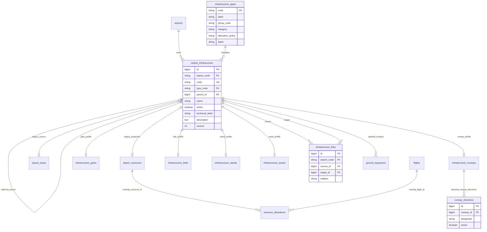

> Cập nhật 10/11/2026: quyết định hiện hành là **10 loại / 4 nhóm**, đã tinh gọn database thật. Xem [báo cáo triển khai và ánh xạ](m01-infrastructure-simplification-report.md). Nội dung 41 loại bên dưới được giữ làm lịch sử khảo sát trước quyết định này.

# Mô hình cơ sở hạ tầng sân bay

Ngày khảo sát/triển khai: 09/11/2026. Phạm vi: mã nguồn và Docker cục bộ của Airline Smart. Danh mục mở rộng là đề xuất của người dùng, chưa được coi là BA phê duyệt. Xem [bảng rà soát BA](airport-infrastructure-ba-review.md).

## 1. Lựa chọn kiến trúc

`airport_infrastructure.id` là định danh chuẩn cho một đối tượng vật lý tại một sân bay. `infrastructure_types` phân biệt công trình/khu vực (`facility`), tài nguyên (`resource`) và hạng mục vận hành (`asset`). Phân loại resource không đồng nghĩa được phép xếp lịch. Thuộc tính chuyên biệt nằm trong các bảng hồ sơ riêng, không dồn mọi loại vào một bộ trường hoặc JSON không có cấu trúc.

`airport_resources` giữ nguyên khóa chính mà M18 đang dùng. Cột `infrastructure_id` biến bản ghi này thành lớp tương thích/phân lịch cho hồ sơ chuẩn, không phải một cổng hay vị trí đỗ vật lý khác. Chỉ GATE/COUNTER/STAND mới tạo lớp tương thích qua luồng M01 mới. Các TERMINAL cũ vẫn giữ bản ghi nguồn và ID cũ.

Phương tiện M11 tiếp tục ở `ground_equipment`; không sao chép thành hạ tầng. Cột vị trí tùy chọn chỉ tham chiếu hồ sơ do M01 quản lý. Bảng hồ sơ asset hiện áp dụng cho cầu ống lồng; chưa hợp nhất danh mục thiết bị M11 thành asset.

## 2. ERD triển khai

Các bảng trong hình thuộc connection `ops` (db1). Hình thể hiện các quan hệ mới và các quan hệ cũ chính; không phải toàn bộ ERD dự án.

`master_changes.entity=airport_infrastructure` và `record_id` lưu đề nghị trước/sau. `audit_logs` lưu sự kiện và đầy đủ snapshot. Đây là quan hệ đa hình do ứng dụng kiểm tra, **không có FK mới** từ `record_id`/`object_id` tới hạ tầng.

`mysql` (db2) chứa users, booking/check-in/boarding/hành lý; `finance` (db3) chứa thanh toán/sổ cái. Không tạo FK xuyên node. Actor/reviewer tiếp tục dùng ID người dùng theo kiến trúc hiện có.

## 3. Bảng, cột và ràng buộc

| Bảng | Cột chính / thay đổi | Ràng buộc thực tế |
|---|---|---|
| infrastructure_types | code varchar40 PK; label160; group_code24; category16; allocation_policy32 nullable; basis24 | Danh mục 41 loại từ InfrastructureCatalog; tham chiếu bằng FK |
| airport_infrastructure | id bigint PK; airport_code3; code60; name160 nullable; type_code40; parent_id nullable; active; technical_state24 nullable; description text; version; timestamps | Unique (airport_code,code), unique (id,airport_code); FK airport, type; FK cha ghép (parent_id,airport_code) cùng sân bay |
| airport_resources | Thêm infrastructure_id nullable unique | FK ghép cùng sân bay tới hồ sơ chuẩn; giữ mọi cột/ID cũ |
| airport_areas | Thêm infrastructure_id nullable unique | FK ghép cùng sân bay; giữ ID, tên, type, metadata, quan hệ nguồn cũ |
| infrastructure_gates | infrastructure_id PK/FK; serves_departures, serves_arrivals nullable | Một cổng, hai khả năng độc lập; NULL nghĩa chưa biết |
| infrastructure_runways | infrastructure_id PK/FK; length_m,width_m decimal(10,2) nullable; limitations text nullable | Một đường băng vật lý; kích thước nhập khi có số đo |
| runway_directions | id; runway_id; designator12; active; timestamps | FK đến PK hồ sơ runway; unique (runway_id,designator). Hướng bỏ khỏi danh sách chuyển active=false, giữ ID |
| infrastructure_belts | infrastructure_id PK/FK; baggage_flow16 nullable | ARRIVAL/DEPARTURE xác định từ loại được chọn; BELT cũ chưa xác định |
| infrastructure_stands | infrastructure_id PK/FK; compatibility_notes nullable | Ghi chú tham khảo, chưa dùng để tự quyết định tương thích |
| infrastructure_assets | infrastructure_id PK/FK; asset_reference120 nullable | Tham chiếu cầu ống lồng; không tạo phương tiện mặt đất thứ hai |
| infrastructure_links | id; airport_code; source_id; target_id; relation24; timestamps | Hai FK ghép cùng sân bay; unique (source_id,target_id,relation); ứng dụng hiện chỉ ghi GATE_STAND |
| ground_equipment | Thêm location_infrastructure_id nullable | FK ghép (location_infrastructure_id,airport_code); không đổi quy tắc phân công |
| audit_logs | before_state/after_state từ varchar255 sang LONGTEXT nullable | Giữ dữ liệu cũ; đủ dung lượng cho snapshot có hồ sơ/quan hệ |
| resource_allocations | Không sửa schema, dữ liệu, khóa hay quy tắc | Vẫn tham chiếu airport_resources.id và flights.id |

FK kiểm tra sân bay và tồn tại; kiểm tra loại hồ sơ, loại quan hệ, chu trình, quyền và duyệt độc lập thuộc service. Không tuyên bố database tự ngăn được mọi chu trình khi ghi SQL trực tiếp.

## 4. Danh mục 41 loại, 6 nhóm

| Nhóm UI | Mã loại được hỗ trợ |
|---|---|
| Nhà ga và khu vực | TERMINAL, PASSENGER_TERMINAL, CARGO_TERMINAL, LEVEL, DEPARTURE_HALL, ARRIVAL_HALL, CHECKIN_AREA, SECURITY_AREA, IMMIGRATION_AREA, CUSTOMS_AREA, WAITING_AREA, CLAIM_AREA, ZONE |
| Cổng và quầy phục vụ | GATE, ARRIVAL_EXIT, COUNTER, BAG_DROP, BUS_BOARDING_POINT, JET_BRIDGE |
| Hệ thống hành lý | BELT, ARRIVAL_BELT, DEPARTURE_BELT, BAG_SORTING_AREA, BAG_MAKEUP_AREA, OVERSIZE_BAG_POINT |
| Đường băng và khu bay | RUNWAY, TAXIWAY, TAXILANE, APRON, STAND, HOLDING_AREA, RESTRICTED_AREA |
| Hạ tầng hỗ trợ | HANGAR, MAINTENANCE_AREA, FUEL_AREA, FIRE_STATION |
| Hạ tầng phụ trợ | GROUND_VEHICLE_AREA, CARGO_WAREHOUSE, VEHICLE_PARKING, DROPOFF_AREA, ACCESS_AREA |

GATE/COUNTER/STAND/BELT/ARRIVAL_BELT/DEPARTURE_BELT/BAG_DROP/BUS_BOARDING_POINT có category resource. JET_BRIDGE có category asset. Còn lại facility. Chỉ GATE/COUNTER/STAND có `allocation_policy=DEPARTURE_WINDOW`; trường này mô tả quy tắc đã có, không sinh lịch.

`basis=LEGACY_SOURCE` cho TERMINAL/ZONE/GATE/COUNTER/STAND/BELT vì schema/code cũ hỗ trợ, không khẳng định đã có dữ liệu tất cả sáu loại. Các loại khác là USER_PROPOSAL. Không có nhãn BA_APPROVED tự gán.

## 5. Quan hệ và validation

- Mọi đối tượng thuộc sân bay thực. Mã duy nhất trong **toàn bộ danh mục cùng sân bay**, kể cả khác loại; DB collation áp dụng cho so sánh mã. Mã, sân bay và loại bất biến sau khi tạo trong luồng này; việc đổi mã/phân loại lại cần chốt quy trình BA.
- Parent tùy chọn. Không suy từ tiền tố mã; không tự gán nhà ga. Parent phải cùng sân bay, category facility; duyệt ngược chuỗi để chặn chu trình. Nhà ga/RUNWAY/TAXIWAY trực thuộc sân bay; LEVEL nếu có parent chỉ thuộc nhà ga; sảnh nếu có parent thuộc nhà ga/tầng; STAND nếu có parent chỉ thuộc APRON. Ma trận vị trí chi tiết cho các loại khác còn chờ BA.
- GATE có thể phục vụ đi, đến hoặc cả hai mà chỉ có một ID; ARRIVAL_EXIT là cửa ra sảnh riêng. GATE_STAND chỉ khi người dùng khai báo quan hệ đã xác nhận, cùng sân bay và đúng loại STAND. Không tự áp dụng quan hệ này để gán chuyến.
- Một RUNWAY có nhiều runway_directions. Không suy ra hướng đối ứng, không tự đo kích thước, không xếp lịch/cấp phép cất hạ cánh. Giới hạn số học của kích thước theo decimal(10,2), không phải chuẩn an toàn hàng không.
- Thuộc tính không áp dụng cho loại được chọn bị backend từ chối. Optional field bị bỏ qua trong partial update được giữ lại; explicit null có thể xóa trường nullable. Form UI gửi đủ trường của loại.
- Duyệt sửa dùng snapshot + version để phát hiện nguồn đã đổi. Người lập không tự duyệt. Ngừng hiệu lực tài nguyên bị chặn nếu còn phân bổ có ends_at trong tương lai, theo ràng buộc cũ.

## 6. Ba trục trạng thái độc lập

| Trục | Giá trị / ý nghĩa | Tác động hiện tại |
|---|---|---|
| Hiệu lực | active=true/false: Có hiệu lực/Ngừng hiệu lực | Đồng bộ lớp nguồn cũ; kiểm tra phân bổ đang còn hiệu lực trước khi duyệt tắt |
| Tình trạng kỹ thuật/vận hành hạng mục | NULL: Chưa xác định; NORMAL, MAINTENANCE, RESTRICTED, OUT_OF_SERVICE | Thông tin được khai báo và duyệt; chưa tự hủy lịch, chuyển chuyến hay chặn lịch theo chính sách mới |
| Sử dụng theo lịch | Tổng bản ghi lịch; số khoảng starts_at <= thời điểm xem < ends_at | Chỉ kết luận có lịch bao phủ thời điểm đó; không khẳng định đang sử dụng vật lý. Nhiều khoảng giao nhau được hiển thị là cần kiểm tra, không tự sửa lịch |

Bốn trạng thái vận hành **sân bay** của lượt trước giữ nguyên; không suy từ hạng mục lên sân bay, không định nghĩa ngưỡng High/Overload. Active không biểu thị trống lịch. M18 vẫn kiểm tra overlap bằng quy tắc cũ.

## 7. Ánh xạ và tương thích dữ liệu cũ

`airline:normalize-infrastructure` mặc định kiểm tra; `--apply` mới ghi. Chỉ cho local/testing. Quy trình kiểm tra mã, loại, mapping đã có, quan hệ nguồn và các nguồn trùng trước khi ghi transaction.

| Nguồn | Cách xử lý |
|---|---|
| airport_resources có mã duy nhất, chưa liên kết | Tạo một hồ sơ cùng airport/code/type/active; name, parent, technical_state để NULL. Chỉ cập nhật cột infrastructure_id mới trên nguồn |
| airport_areas có mã duy nhất, chưa liên kết | Giữ name/type/active thực; map parent theo ID nguồn đã kiểm chứng; giữ metadata ở nguồn và hiển thị trên chi tiết |
| TERMINAL ở cả hai nguồn cùng sân bay/mã | Báo conflict, **dừng toàn bộ apply**. Không merge theo tên/mã, không tạo hai nhà ga. UI không trình bày hai dòng trùng như hai đối tượng đã xác minh |
| Mapping đã có | Kiểm tra airport/code/type; không tạo lại. Chạy lại không ghi đè các chỉnh sửa chuẩn sau import |
| Nguồn legacy được tạo/sửa qua API cũ | Adapter trong transaction đồng bộ hồ sơ chuẩn; giữ ID/response cũ. Chặn đổi identity đã map và chặn quan hệ sai |
| Đề nghị resource cũ trước migration | So sánh snapshot bỏ qua infrastructure_id mới để không làm đề nghị cũ bị stale chỉ vì thêm mapping |
| M18 hiện hữu | Không rewrite resource_id/flight_id/thời gian/lý do. M03 join qua chính allocation đó |

Tại snapshot cục bộ: 644 resources (44 TERMINAL, 200 GATE, 200 COUNTER, 200 STAND), 0 areas. Không có conflict hai nguồn nhà ga trong dữ liệu này. 44 nhà ga giữ loại chưa phân loại; không đoán hành khách/hàng hóa. Tất cả quan hệ cha và tình trạng kỹ thuật import để NULL.

## 8. Vận hành và giới hạn rollback

Migration mở rộng `2026_11_09_010000_normalize_airport_infrastructure.php` không tự backfill. Tách lệnh chuẩn hóa để kiểm tra conflict trước, có thể replay và giữ nguyên nguồn cũ. Phải backup/restore và chạy test trước mỗi môi trường mới; không dùng migrate:fresh/db:wipe.

`down()` đã thử trên bản sao chưa có nghiệp vụ hạ tầng mới. Nó từ chối nếu có audit tạo/sửa hạ tầng mới, vị trí thiết bị mặt đất không NULL hoặc audit dài hơn 255 ký tự; lúc đó cần migration chuyển dữ liệu được rà soát thay vì xóa schema mới. Không tuyên bố rollback sau mọi hoạt động mới là an toàn. Không chạy down trên DB làm việc.

Đường công khai `/api/v1/actions/allocate` vẫn giữ hợp đồng và khả năng cũ, gồm việc validator cũ không giới hạn ba loại. UI mới và `/workspace/infrastructure-allocations` giới hạn ba loại đã xác nhận có luồng. Chính sách ngừng luồng legacy cần BA và kế hoạch tương thích riêng.
