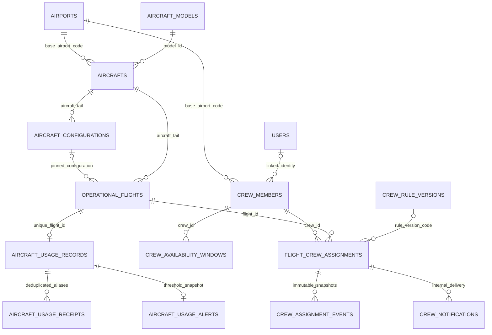

# Mở rộng ERD M04/M06

Sáu bảng mới bổ sung, giữ nguyên 20 thực thể nền. Các FK mới restrict delete; snapshot cấu hình/event không có route sửa/xóa. Sơ đồ chỉ mô tả phần đã triển khai tại checkpoint tài nguyên, không đại diện schema của các module chưa làm.

`aircrafts.current_configuration_id` trỏ về bản hiện hành; mỗi flight giữ riêng `aircraft_configuration_id` và `seat_capacity_snapshot`. `source/external_id` unique trên receipts; unique flight_id của ledger bảo vệ số dư kể cả nguồn gửi alias khác nhau. Crew assignment có approved_by/confirmed_by nullable cho legacy/CLI và SELF/OPERATOR cho xác nhận mới; không tự bịa actor cho dữ liệu cũ.
