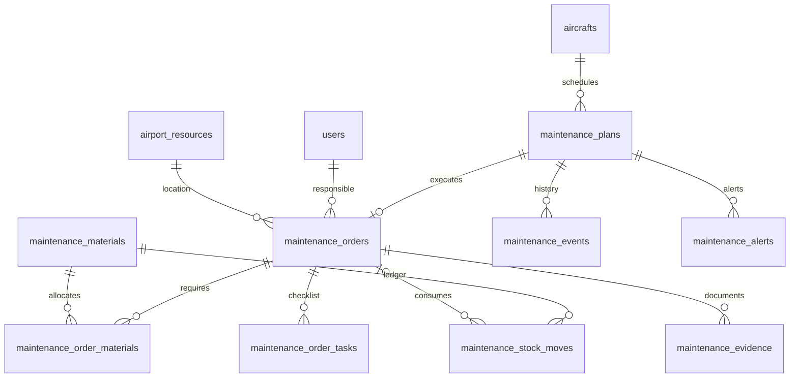

# M05 — mở rộng ERD

Migration `2026_10_18_000008_complete_maintenance_workflows` cộng thêm bảng/FK, giữ maintenance_orders và tất cả hồ sơ cũ. Không backfill kế hoạch, chữ ký hoặc chứng nhận từ dữ liệu demo/text.

Orders mới có plan_id unique. Legacy plan_id null được đánh dấu cần rà soát; chuyển hồ sơ giữ ID/order_code và snapshot gốc. FK restrict delete. Vật tư unique airport/code; ledger unique material/reference; requirements unique order/material; alerts unique plan/kind. Tồn kho MySQL unsigned; nhập/xuất integer và kiểm overflow/shortage server-side. Lịch sử và phiếu kho không có API sửa/xóa.

PlanningLock dùng chung M02/M03/M04/M05/M06, lấy trước đọc nghiệp vụ trong transaction rồi khóa plan/order/aircraft và vật tư theo ID. Scheduler dùng cùng khóa. File được ghi trước transaction metadata, cleanup đúng file mới nếu thất bại; kiểm lại trạng thái/scope khi commit. Hoàn tất và giải phóng kiểm SHA256, fail closed khi file mất/sửa.
