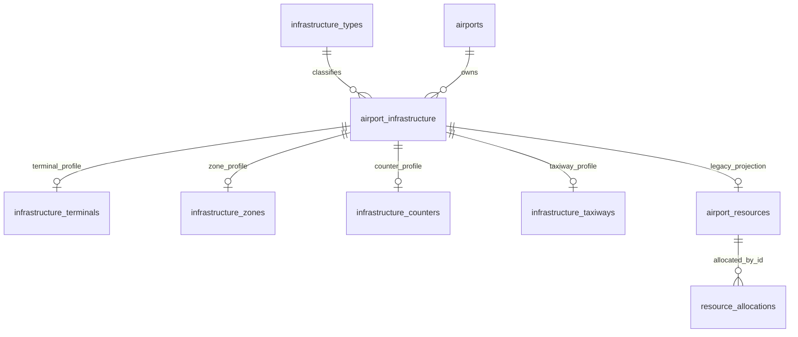

# M01 — Chốt 10 loại cơ sở hạ tầng

Ngày triển khai: 10/11/2026, môi trường Docker local của dự án. Đây là quyết định mới của người dùng, thay thế đề xuất 41 loại trong các tài liệu khảo sát trước.

## 1. Kết quả trên database làm việc

Đã chạy migration `2026_11_10_010000_simplify_airport_infrastructure_catalog.php` trên database **airline cục bộ**. Bảng `ops.infrastructure_types` thực sự chỉ còn **10 bản ghi, 4 nhóm**. Backend validation, danh mục trên form/bộ lọc và Seeder dùng cùng `InfrastructureCatalog`; không chỉ ẩn loại trên giao diện.

Không commit/push, không reset database, không chạy migrate:fresh/db:wipe, không xóa volume và không truy cập database production/dùng chung.

| Đối tượng | Trước | Sau |
| --- | ---: | ---: |
| Loại hạ tầng chính thức | 41 | 10 |
| Nhóm quản lý | 6 | 4 |
| Hồ sơ `airport_infrastructure` | 644 | 644 |
| Tài nguyên `airport_resources` | 644 | 644 |
| Khu vực nguồn cũ `airport_areas` | 0 | 0 |
| Phân bổ `resource_allocations` | 2.918 | 2.918 |
| Sân bay | 22 | 22 |
| Chuyến bay | 987 | 987 |
| Audit ops | 1.811 | 1.811 |
| Đề nghị master_changes | 5 | 5 |
| Tài khoản | 858 | 858 |
| Hồ sơ TERMINAL | 44 | 44 |
| Hồ sơ GATE | 200 | 200 |
| Hồ sơ COUNTER | 200 | 200 |
| Hồ sơ STAND | 200 | 200 |
| Hồ sơ thuộc 6 loại chính thức còn lại | 0 | 0 |
| Hồ sơ thuộc 31 loại bị loại | 0 | 0 |

Đã so sánh số lượng và SHA-256 của từng dòng dữ liệu trong **109 bảng** trên ba connection ops/mysql/finance, trước và sau áp dụng: **không có bảng được bảo vệ nào thay đổi**. Các bảng loại, sổ migrations và năm bảng mới được tách khỏi phép so sánh vì đây là thay đổi dự kiến. Việc đối chiếu bao gồm ID, active, condition, quan hệ, audit, master_changes, tài khoản, trạng thái sân bay, chuyến bay và dữ liệu các phân hệ khác.

Kiểm tra toàn vẹn cuối: 0 phân bổ mồ côi, 0 hồ sơ tham chiếu loại không tồn tại, 0 tài nguyên thiếu/sai liên kết ID, loại hoặc sân bay so với hồ sơ chuẩn.

Không tự gán loại nhà ga/chức năng quầy cho dữ liệu hiện hữu khi chưa có căn cứ. Bốn bảng thuộc tính mới chưa có bản ghi trên database làm việc; các trường chưa xác nhận tiếp tục để trống.

## 2. Danh mục chính thức: giữ nguyên đủ 10 mã mục tiêu

Cả 10 mã đã tồn tại trong danh mục cũ, không cần đổi mã hay cấp lại ID vật lý.

| Nhóm | Mã | Tên hiển thị |
| --- | --- | --- |
| Nhà ga và khu vực | TERMINAL | Nhà ga |
| Nhà ga và khu vực | ZONE | Khu vực nhà ga |
| Cổng và quầy phục vụ | GATE | Cổng lên/xuống máy bay |
| Cổng và quầy phục vụ | COUNTER | Quầy làm thủ tục |
| Cổng và quầy phục vụ | JET_BRIDGE | Cầu ống lồng |
| Hệ thống hành lý | BELT | Băng chuyền hành lý |
| Khu bay và sân đỗ | RUNWAY | Đường băng |
| Khu bay và sân đỗ | TAXIWAY | Đường lăn |
| Khu bay và sân đỗ | APRON | Sân đỗ máy bay |
| Khu bay và sân đỗ | STAND | Vị trí đỗ máy bay |

Khóa nhóm trong mã nguồn: `terminal`, `passenger`, `baggage`, `airfield`. Nhãn loại và thuộc tính dùng chung nguồn định nghĩa. Ba loại được phân bổ theo nghiệp vụ M18 hiện có vẫn là **GATE/COUNTER/STAND**.

## 3. Ánh xạ đủ 41 loại cũ

10 loại ở mục 2 được giữ nguyên. **31 mã dưới đây đã xóa khỏi bảng infrastructure_types trên local**; tất cả đều có 0 hồ sơ ở thời điểm khảo sát.

17 mã có ánh xạ ngữ nghĩa chính xác được chuẩn bị trong migration, để xử lý an toàn một database khác nếu có dữ liệu phù hợp. Các phép chuyển đổi giữ nguyên từng đối tượng và ID; không gộp nhiều hồ sơ thành một.

| Mã cũ đã loại | Loại đích | Thuộc tính lưu lại nếu có hồ sơ |
| --- | --- | --- |
| PASSENGER_TERMINAL | TERMINAL | terminal_kind=PASSENGER |
| CARGO_TERMINAL | TERMINAL | terminal_kind=CARGO |
| LEVEL | ZONE | zone_function=LEVEL |
| DEPARTURE_HALL | ZONE | zone_function=DEPARTURE_HALL |
| ARRIVAL_HALL | ZONE | zone_function=ARRIVAL_HALL |
| CHECKIN_AREA | ZONE | zone_function=CHECKIN |
| SECURITY_AREA | ZONE | zone_function=SECURITY |
| IMMIGRATION_AREA | ZONE | zone_function=IMMIGRATION |
| CUSTOMS_AREA | ZONE | zone_function=CUSTOMS |
| WAITING_AREA | ZONE | zone_function=WAITING |
| CLAIM_AREA | ZONE | zone_function=BAGGAGE_CLAIM |
| BAG_SORTING_AREA | ZONE | zone_function=BAG_SORTING |
| BAG_MAKEUP_AREA | ZONE | zone_function=BAG_MAKEUP |
| BAG_DROP | COUNTER | counter_service=BAG_DROP |
| ARRIVAL_BELT | BELT | baggage_flow=ARRIVAL |
| DEPARTURE_BELT | BELT | baggage_flow=DEPARTURE |
| TAXILANE | TAXIWAY | taxiway_function=STAND_ACCESS |

14 mã dưới đây không có phép chuyển đổi vật lý tự động đủ căn cứ. Vì không có hồ sơ/phụ thuộc đang dùng chúng trên local, metadata của chúng đã được xóa an toàn. Nếu gặp hồ sơ thuộc các mã này ở môi trường khác, migration **dừng để đối soát**, không tự biến tất cả thành ZONE hoặc một loại khác.

| Mã cũ đã loại | Lý do không tự chuyển hồ sơ |
| --- | --- |
| ARRIVAL_EXIT | Lối ra không mặc nhiên là cổng máy bay |
| BUS_BOARDING_POINT | Điểm xe buýt không mặc nhiên là cổng vật lý |
| OVERSIZE_BAG_POINT | Điểm phục vụ chưa xác định là quầy, băng chuyền hay khu vực |
| HOLDING_AREA | Chưa xác định phạm vi và chức năng vật lý |
| RESTRICTED_AREA | Phạm vi hạn chế không mặc nhiên là khu vực nhà ga |
| HANGAR | Nhà chứa máy bay là công trình khác nhà ga |
| MAINTENANCE_AREA | Chưa xác nhận khu vực thuộc công trình nào |
| FUEL_AREA | Không có loại tương đương trong 10 loại mục tiêu |
| FIRE_STATION | Trạm cứu hỏa không tương đương nhà ga/khu vực nhà ga |
| GROUND_VEHICLE_AREA | Khu phương tiện mặt đất không mặc nhiên là sân đỗ máy bay |
| CARGO_WAREHOUSE | Kho hàng không mặc nhiên là nhà ga hàng hóa |
| VEHICLE_PARKING | Bãi ô tô khác sân đỗ máy bay |
| DROPOFF_AREA | Khu đón trả khách chưa xác nhận thuộc nhà ga |
| ACCESS_AREA | Phân loại quá chung, thiếu căn cứ xác định đối tượng |

Không còn loại nào bị chặn xóa trên database làm việc. **Không có hồ sơ thật nào cần đổi type_code trong lượt áp dụng này.** Các kiểm thử chuyển đổi 17 mã dùng fixture riêng trong database test, không đưa dữ liệu đó vào database làm việc.

## 4. Thuộc tính và quan hệ

- Nhà ga: `terminal_kind` (hành khách/hàng hóa/kết hợp), `serves_departures`, `serves_arrivals`. Nhà ga và khu vực vẫn là hai loại riêng.
- Khu vực: `zone_function` (tầng, sảnh đi/đến, làm thủ tục, an ninh, xuất nhập cảnh, hải quan, chờ, nhận/phân loại/tập kết hành lý...). Phân cấp khu vực vẫn dùng parent_id, không suy diễn quan hệ từ mã/tên.
- Cổng: tiếp tục hai cờ phục vụ đi/đến, một ID vật lý và các liên kết GATE_STAND đã được xác nhận; không nhân đôi theo luồng khách.
- Quầy: `counter_service` CHECKIN/BAG_DROP/COMBINED.
- Băng chuyền: `baggage_flow` ARRIVAL/DEPARTURE/BOTH; kết hợp chỉ được ghi khi người dùng xác nhận qua nhập liệu/duyệt.
- Đường lăn: `taxiway_function` GENERAL/APRON/STAND_ACCESS/EXIT.
- Đường băng: giữ hồ sơ kích thước/giới hạn và bảng runway_directions cho các hướng trên cùng một đường băng vật lý.
- Sân đỗ/vị trí đỗ: tiếp tục quan hệ cha/con đã xác nhận; không tự tạo sân đỗ cho các vị trí đang thiếu thông tin.
- Cầu ống lồng: loại riêng, profile thiết bị `infrastructure_assets`, không nhập vào GATE hay phương tiện M11.

Frontend có trường nhập/xem thuộc tính theo từng loại. Backend từ chối thuộc tính sai loại/giá trị ngoài danh mục; sửa đổi qua đề nghị và người duyệt độc lập. Các cập nhật thiếu trường thuộc tính giữ nguyên giá trị cũ; NULL tường minh cho phép xóa thuộc tính tùy chọn.

## 5. Khảo sát phụ thuộc và bảo toàn lịch sử

Đã kiểm tra foreign key trong information_schema, các bảng hồ sơ chuẩn/nguồn cũ, phân bổ, liên kết, hướng đường băng, vị trí phương tiện, master_changes và JSON audit trước/sau. FK tới loại hiện chỉ từ airport_infrastructure.type_code. Các FK tới ID chuẩn/tài nguyên vẫn giữ nguyên.

Không có tham chiếu type/type_code thuộc 31 mã trong audit/master_changes ở thời điểm khảo sát local. Migration vẫn lưu metadata gốc vào `infrastructure_simplification_archive`; phép chuyển đổi có audit riêng chứa loại trước/sau và thuộc tính. Không viết lại hoặc xóa audit/đề nghị đã có.

`database/data/infrastructure-types-v1.json` là ảnh chụp metadata lịch sử, phục vụ đọc nhãn cũ, replay migration gốc và rollback. Đây **không phải danh mục đầu vào đang hoạt động**. Migration gốc được cố định vào ảnh chụp này để việc chạy lại chuỗi migration không bị phụ thuộc định nghĩa mới.

Migration kiểm tra trước khi tạo bảng/xóa loại: mã ngoài danh mục gốc, hồ sơ không ánh xạ được, nguồn cũ chưa liên kết/mâu thuẫn phân loại, băng chuyền mâu thuẫn hướng, đề nghị PENDING chứa phân loại cũ, FK loại ở bảng khác. Giao dịch kiểm tra lại và khóa các hàng sân bay trước khi cập nhật. Khi có lỗi trong giao dịch, dữ liệu cập nhật/xóa được rollback.

Rollback yêu cầu archive tồn tại và dấu vân tay dữ liệu hạ tầng/phân bổ/đề nghị/profile không đổi từ lúc up. Nếu phát sinh thay đổi nghiệp vụ, rollback dừng, không xóa các thuộc tính/bản ghi mới. Với bản sao chưa phát sinh thay đổi, rollback phục hồi chính xác metadata 41 loại, phân loại trước chuyển đổi và nguồn cũ; giữ lại audit.

## 6. Database, sao lưu và môi trường kiểm thử

Sao lưu logic ba node trước khi áp dụng: `backups/20261109T181307Z-21300/db1.sql.gz`, `db2.sql.gz`, `db3.sql.gz`; đã kiểm tra gzip. Đây là bản sao lưu cục bộ riêng tư, không đưa vào Git. Sao lưu ba node không phải snapshot giao dịch phân tán toàn hệ thống.

Khôi phục bản sao vào schema riêng `infra10_verify_20261110` trên cả ba node, dùng tài khoản test. Đã chạy migration up/down/up và đối chiếu 109 bảng: PASS, danh mục 41→10→41→10. Sau kiểm tra, fixture giao diện chỉ được thêm vào schema riêng này.

Kiểm thử Feature chạy trong schema `airline_test`, có guard cả database và username. Không chạy migrate toàn bộ để tránh áp dụng các migration ngoài phạm vi; chỉ chạy migration tinh gọn theo path. Cuối cùng áp dụng cùng migration theo path trên `airline` local và so sánh dữ liệu trước/sau.

Bảng mới trên connection ops:

| Bảng | Nội dung |
| --- | --- |
| infrastructure_terminals | Profile 1:1: loại nhà ga và hai cờ phục vụ |
| infrastructure_zones | Profile 1:1: chức năng khu vực |
| infrastructure_counters | Profile 1:1: chức năng quầy |
| infrastructure_taxiways | Profile 1:1: chức năng đường lăn |
| infrastructure_simplification_archive | Metadata/ảnh trước chuyển đổi và hash kiểm tra rollback |

Mỗi profile mới có PK/FK infrastructure_id tới airport_infrastructure.id. infrastructure_types được cập nhật 10 metadata chính thức và xóa 31 metadata không còn dùng. Các bảng hiện hữu không bị đổi cấu trúc trong migration này.

## 7. File triển khai

- `backend/app/Support/InfrastructureCatalog.php`: 10 mã, 4 nhóm, nhãn, thuộc tính, profile chung.
- `backend/app/Support/InfrastructureLegacyMap.php`, `backend/database/data/infrastructure-types-v1.json`: ánh xạ/metadata lịch sử tách khỏi danh mục hoạt động.
- `backend/app/Support/InfrastructureDisplay.php`, `AirportWorkspace.php`: loại và quan hệ cha phù hợp danh mục mới.
- `backend/app/Modules/Operations/InfrastructureSimplification.php`: preflight, chuyển đổi, xóa metadata, archive và rollback guard.
- `backend/database/migrations/2026_11_10_010000_simplify_airport_infrastructure_catalog.php`: schema thuộc tính và điều phối chuyển đổi.
- `backend/database/migrations/2026_11_09_010000_normalize_airport_infrastructure.php`: cố định metadata lịch sử của migration gốc.
- `backend/app/Modules/Operations/InfrastructureService.php`: validation/profile/ảnh đề nghị tương thích các profile NULL mới.
- `backend/app/Http/Controllers/InfrastructureController.php`: danh mục mới và đọc hồ sơ cũ.
- `backend/app/Http/Controllers/InfrastructureReferenceController.php`: tra cứu hành lý bằng BELT hoặc chức năng ZONE.
- `backend/database/seeders/InfrastructureTypeSeeder.php`, `DatabaseSeeder.php`: seed tham chiếu 10 loại, không tạo lại 31 loại; không dùng seeder để xóa dữ liệu.
- `backend/resources/views/m01/infrastructure-type-picker.blade.php`, `infrastructure-fields.blade.php`, `infrastructure-detail.blade.php`, `infrastructure-attributes.blade.php`, `infrastructure-attribute-details.blade.php`, `value-list.blade.php`: form/chi tiết/nhãn lịch sử thống nhất.
- `backend/tests/Feature/InfrastructureSimplificationTest.php`: kiểm thử chuyển đổi, chặn xóa, rollback, validation, thuộc tính, đề nghị và seeder.
- `backend/tests/Feature/InfrastructureNormalizationTest.php`, `AirportStatusDisplayTest.php`: fixture theo danh mục 10 loại, giữ kiểm tra nghiệp vụ cũ.
- Tài liệu: báo cáo này và chú thích thay thế quyết định trong các báo cáo/mô hình trước.

Các file đang thay đổi của những công việc trước trong workspace được giữ nguyên; không coi toàn bộ git diff là thay đổi của lượt tinh gọn này.

## 8. Kết quả kiểm thử

| Phạm vi | Kết quả |
| --- | --- |
| Migration trên bản sao local | PASS: up/down/up, 41→10→41→10; 109 bảng được bảo vệ giữ nguyên |
| Áp dụng local | PASS: 10 loại / 4 nhóm; 644 hồ sơ, 644 tài nguyên, 2.918 phân bổ; 109 bảng giữ nguyên |
| InfrastructureNormalizationTest | 12/12 PASS: chuẩn hóa ID, cha/con, Gate hai luồng, hướng đường băng, SOD, sửa/duyệt, API cũ, M18 overlap, M10 tham chiếu, M11 vị trí |
| AirportStatusDisplayTest | 10/10 PASS: quyền trạng thái sân bay, nhãn/condition riêng, quan hệ vị trí và đủ bộ lọc 10 loại |
| InfrastructureSimplificationTest cuối | 5/5 PASS qua các lần chạy cuối: 4 bài đã đạt, bài đề nghị/Seeder chạy lại đạt sau sửa assertion so sánh JSON theo giá trị (MySQL chuẩn hóa khoảng trắng JSON) |
| Hồi quy liên phân hệ | 62/64 PASS, 719 assertions: InfrastructureSimplificationTest (4 bài ở lần chạy này), OperationsWorkflowTest, FlightResourceChangeTest, JourneyTest, UseCaseBackendWorkflowTest |
| Blade | artisan view:cache PASS |
| Trình duyệt Chrome | PASS: 46 lượt mở trang, HTTP 200 và đúng đường dẫn, 0 lỗi JavaScript, 0 raw Blade, không tràn chiều ngang toàn trang |
| Desktop/mobile | PASS ở 1920/1440/1024/768/390/320 px; danh sách ở cả sáu chiều rộng, form và chi tiết đủ 10 loại ở 1440 và 320 px; bảng mobile cuộn ngang nội bộ |
| Danh mục giao diện | PASS: select gồm 10 loại + lựa chọn rỗng, chia đúng 4 optgroup |
| Định dạng | Pint cho các PHP thay đổi; git diff --check PASS (chỉ cảnh báo line ending của asset đã có từ trước) |

Hai lỗi hồi quy thuộc kỳ vọng quyền admin đã có trước công việc tinh gọn:

- `OperationsWorkflowTest::test_roles_and_airport_scope_are_checked_for_workspace_and_mutations`: kỳ vọng admin bị 403 ở `/workspace/finance`, cơ chế admin bypass hiện tại trả 200.
- `JourneyTest::test_ownership_and_role_boundaries`: kỳ vọng admin bị 403 ở boarding, cơ chế hiện tại đi tiếp vào validation và trả 422 cho token fixture không hợp lệ.

Không chỉnh Access/RBAC hoặc sửa kỳ vọng của hai test này để làm xanh báo cáo. Cần quyết định chính sách quyền riêng nếu muốn xử lý. Các kiểm thử hành trình hợp lệ, boarding/check-in, phân bổ và đổi tài nguyên vẫn đạt.

Tổng cộng 87 trường hợp Feature khác nhau được thực thi trong các nhóm trên: 85 đạt, 2 lỗi kỳ vọng RBAC đã nêu. Các lỗi fixture ban đầu (thiếu actor_id, dùng API danh mục nguồn cũ thay vì API chuẩn, so sánh chuỗi JSON chưa chuẩn hóa) đã được sửa trong test và kiểm tra lại; không phải thay đổi nghiệp vụ để né lỗi.

Đã xem ảnh chụp desktop/mobile của danh sách. Preview dùng schema riêng, đã dừng sau kiểm tra. Không đưa tài khoản hay fixture trình duyệt vào database làm việc.

Bằng chứng kỹ thuật lưu riêng, đã được Git ignore trong `backend/storage/app/private/`: `infra10-survey.json`, `infra10-migration-verification.json`, `infra10-main-verification.json`, `infra10-final-integrity.json`, các log `infra10-tests.log`, `infra10-regression.log`, `infra10-final-tests.log`, `infra10-pending-test.log`, `infra10-browser-results.json` và ảnh `infra10-infrastructure-desktop.png`, `infra10-infrastructure-mobile.png`.

## 9. Cập nhật BA, Use Case và ERD

- Use Case M01: danh mục chính thức 10 loại/4 nhóm; thuộc tính tùy loại; quan hệ nhà ga–khu vực và sân đỗ–vị trí đỗ; mã/loại/ID đã tạo không đổi qua form sửa; đề nghị/duyệt và phân tách người lập/người duyệt giữ nguyên.
- Business Analysis: bỏ 31 loại khỏi danh mục nghiệp vụ hoạt động. Phân biệt loại đối tượng vật lý với chức năng phục vụ, hiệu lực danh mục, condition hạ tầng và trạng thái vận hành sân bay. Không suy diễn dữ liệu thực từ ví dụ/fixture.
- ERD/data dictionary: bổ sung bốn bảng profile 1:1 và bảng archive migration; giữ type_code FK, self/composite FK theo sân bay, airport_resources.infrastructure_id và resource_allocations.resource_id.
- M03/M18: giữ GATE/COUNTER/STAND và ID tài nguyên cũ; không thêm phân lịch RUNWAY/TAXIWAY/BELT.
- M09: quy trình check-in/boarding và Gate không đổi.
- M10: thay điều kiện mã chi tiết cũ bằng BELT và chức năng ZONE; chỉ tra cứu, không tự gán băng chuyền theo chuyến.
- M11: thiết bị/vị trí vẫn tham chiếu hồ sơ cùng sân bay; không biến APRON/ZONE thành phương tiện hay tự tạo nhiệm vụ.
- Tài liệu 41 loại cũ giữ làm lịch sử phân tích, đặt chú thích trỏ về quyết định hiện tại; không dùng làm danh mục chính thức nữa.

Phần ERD bổ sung cho profile mới (FK ở mỗi bảng là infrastructure_id):

Các profile GATE/BELT/RUNWAY/STAND/JET_BRIDGE và liên kết/hướng khai thác tiếp tục như mô hình trước. Bảng archive là bản ghi phục hồi migration, không tham gia danh mục nghiệp vụ.

## 10. Giới hạn

Không có dữ liệu thật của 31 loại để đối soát vật lý; chuyển đổi 17 mã được chứng minh bằng fixture và giữ nguyên ID, không phải kiểm chứng từng công trình ngoài thực tế. 14 mã còn lại cần BA xác nhận từng trường hợp nếu dữ liệu mới xuất hiện ở môi trường khác.

Các thuộc tính/quan hệ hiện chưa được khai báo không được tự điền. RBAC, quyền trạng thái sân bay và nghiệp vụ điều phối giữ nguyên. Các migration DDL của MySQL không nằm trọn trong transaction: preflight chạy trước DDL và lặp lại trong transaction dữ liệu; nếu lỗi hạ tầng xảy ra giữa chừng, cần kiểm tra các bảng mới trước khi chạy lại, không reset database.
